# OpenKIS manual

OpenKIS (Opensource Karst Information System) is the software that cave registers use to
publish and manage on the web their data on caves, artificial cavities, karst springs, tracer
tests, fauna, glaciers and bibliography. This manual explains how to browse a register, how
to add and update records, how to link the register to [Grottocenter](https://grottocenter.org)
and how to administer the site.

The screenshots come from a local copy of the **Catasto Speleologico Ligure**, the cave
register of Liguria (real data, `openkis_liguria` theme), with the English interface. Other
registers run the same software, but their menus, fields, maps and colours can differ. Some
features (PDF register sheet, automatic numbering, regional maps) are customisations of the
Liguria register and are marked as such. A few labels of the Liguria register have no
English translation and appear in Italian or as raw field names.

Versione italiana: [MANUAL_IT.md](MANUAL_IT.md).

## Contents

1. [Getting started](#1-getting-started)
2. [The map](#2-the-map)
3. [Searching caves](#3-searching-caves)
4. [The cave sheet](#4-the-cave-sheet)
5. [Adding and editing records](#5-adding-and-editing-records)
6. [The other archives](#6-the-other-archives)
7. [Exporting data](#7-exporting-data)
8. [Grottocenter](#8-grottocenter)
9. [AI assistants (MCP server)](#9-ai-assistants-mcp-server)
10. [Administration](#10-administration)
11. [Glossary](#11-glossary)

---

## 1. Getting started

### Home page and menu

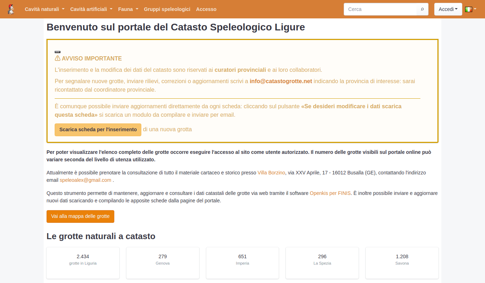

The top bar contains:

- the **menu** with the archives: *Natural Cave* (caves, map, surveys, areas, cave systems,
  tracer tests, springs, bibliography), *Artificial caves*, *Fauna*, *Caving clubs*; after
  login, *Settings* and *Report* also appear for users with the rights;
- the **Search** box, which searches the whole site;
- the **Login** button (or the name of the logged-in user);
- the **flag** to change language (Italian, English, ... depending on the languages enabled).

Each register writes its own home page. In Liguria it explains who can edit the data and how
to send reports, and shows the number of caves per province.

### Login

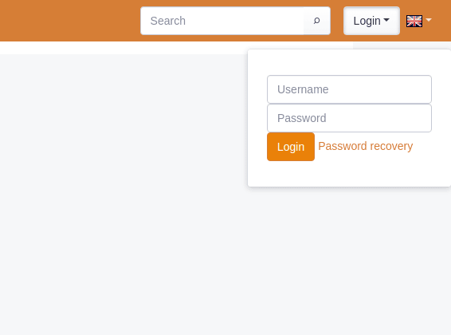

**Login** opens the form with user name and password; *Password recovery* sends by email the
instructions to choose a new one. If the administrator has opened registration, anyone can
create an account; otherwise accounts are created by the administrator.

### Who sees what

What you see depends on your access level:

| User | What they can do |
| --- | --- |
| Visitor (not logged in) | Browses the public sections (in Liguria caves, map, artificial cavities, surveys, bibliography, fauna); does not see restricted records |
| Registered user | Like the visitor, plus the sections open to registered users |
| Reader (`r_caves`, `r_artificials`, ...) | Also sees the read-restricted sections (e.g. karst springs) |
| Curator (`w_caves`, `w_artificials`, `w_fauna`) | Adds and edits the records of their archive |
| Special groups (`hidden_caves`, `archaeologists`, ...) | See the records restricted to those groups |
| Administrator | Everything, including control center, permissions and configuration |

These are the default group names; each register can create others (see
[Users and groups](#users-and-groups)).

After login, the *Settings* menu gathers the support tables and tools (geological
formations, coordinate types, Grottocenter, licence types, MCP server):

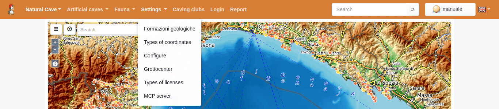

---

## 2. The map

*Natural Cave > Mappa cavità naturali* (map of natural caves) shows all the caves the user
can see. Each symbol shows the kind of cave (absorbing, emitting, ascending, descending,
horizontal, closed, with water, with bats, blowing or sucking air): the **Legend** below the
map explains them. *Open map in full screen* enlarges it to the whole screen.

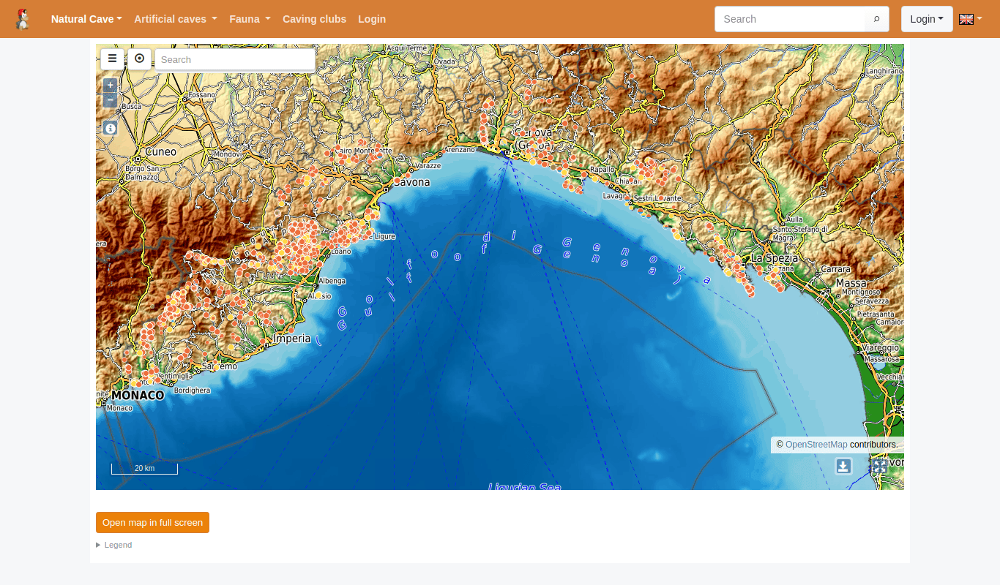

### Tools

| Button | What it does |
| --- | --- |
| ☰ (menu) | Chooses the base map and switches the layers on and off |
| ⦿ | Centres the map on the device position (GPS) and follows it; dragging the map stops following |
| Search | Finds a cave by number or name among those loaded; with `lat,lon` in decimal degrees it moves the map there |
| + / − | Zoom |
| (i) Info | Info mode: a click on an empty spot shows coordinates, address and number of caves of the municipality (see below) |
| ⛶ (bottom) | Full screen |

At the bottom left are the scale bar and the WGS84 coordinates of the pointer. On phones and
tablets the map moves with two fingers (one finger scrolls the page).

### Maps and layers

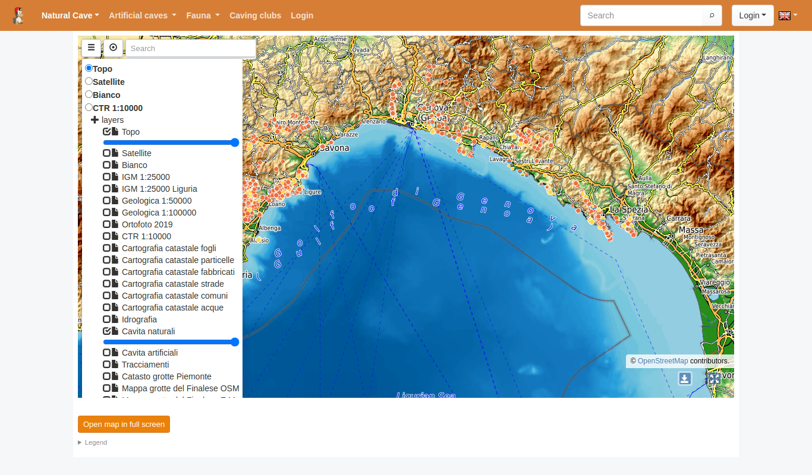

The ☰ menu lists the **base maps** (in Liguria: Topo, Satellite, Bianco = grey, CTR
1:10000) and the **layers**, each with a check box and an opacity slider:

- cartography: IGM 1:25000 topographic maps, 1:50000 and 1:100000 geological maps, aerial
  photos, regional technical map (CTR), land registry (sheets, parcels, buildings, roads),
  hydrography;
- register data: natural caves, karst springs, artificial cavities, tracer tests (arrows
  from the injection point to the detection point), surveys (the KML plans uploaded with the
  surveys);
- external layers, such as the registers of neighbouring regions.

A layer appears only if the user can see the matching section: for example in Liguria the
springs are visible only to the `r_caves` and `w_caves` groups.

### Finding and opening a cave

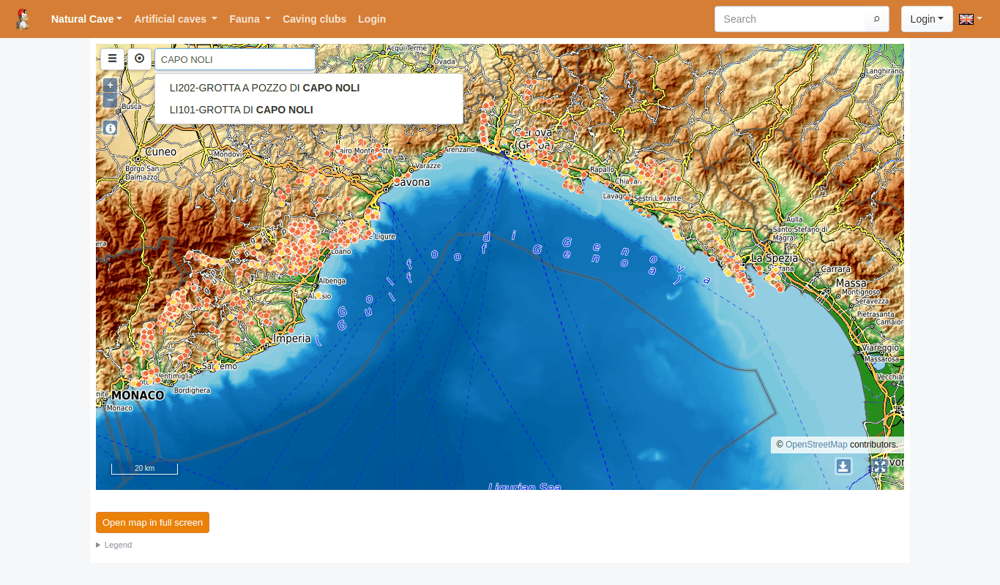

Typing in the *Search* box lists the caves with that number or name; choosing one moves the
map to the entrance. A click on a symbol shows the popup with photo, elevation, length and
depth and the links *open* (the sheet, in a new window) and *go to* (the route on Google
Maps):

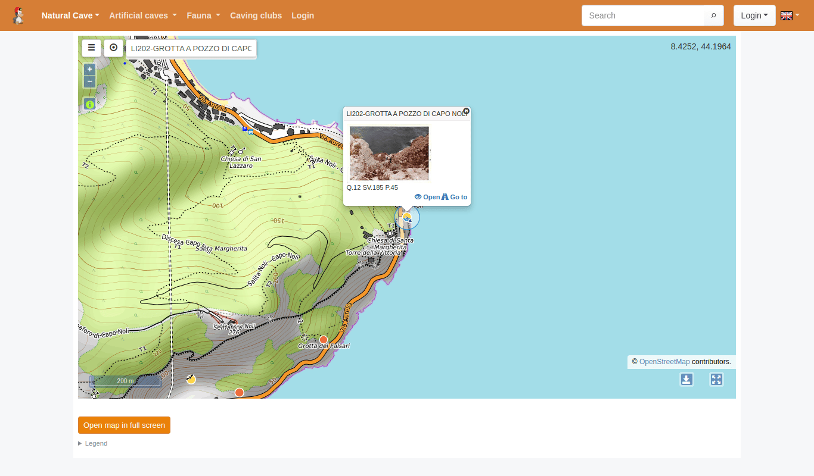

When several symbols overlap, the popup lists the nearby points: the name opens the sheet,
the icon next to it shows the popup of the point. In **Info** mode a click on an
empty spot shows the coordinates (with a *Copy coordinates* button), the address, and how
many caves there are in that municipality and province.

---

## 3. Searching caves

*Natural Cave > Grotte* (caves) shows the list of records. At the top a map shows the
results and follows every search.

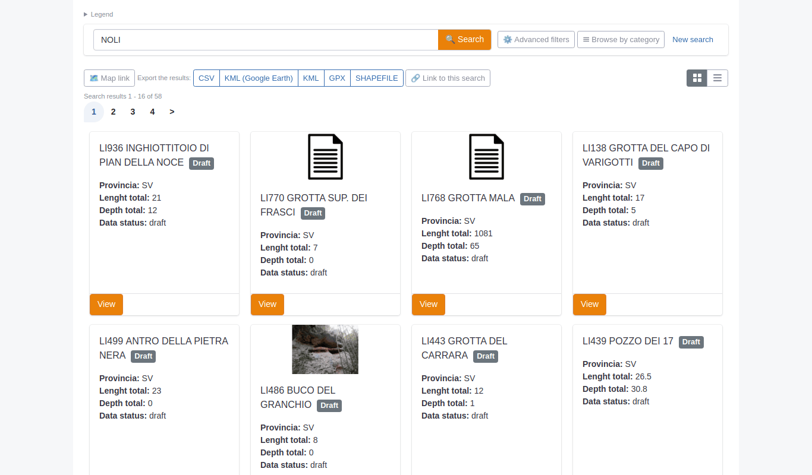

- **Free search**: the *Search caves* box finds the records that contain the text, in any
  field (in the example, *NOLI* finds the caves of the municipality of Noli and those that
  mention Noli in their texts). With several words, one of them is enough: use the
  *Advanced filters* to narrow the search.
- **New search** clears the filters.
- Each record appears as a card with entrance photo, number, name, main data and a badge with
  the **data status** (*Draft*, *Verify*, *Validated*, *Rejected*). **View** opens the sheet.
- The buttons on the right switch between card view and list view.
- Results come in pages of 16.

### Advanced filters

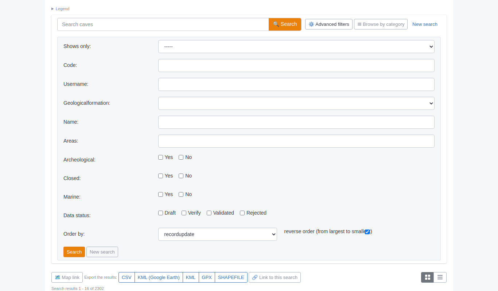

*Advanced filters* searches by code, name, karst area, geological formation, user who
entered the data, archaeological, closed or marine caves and data status, and sets the sort
order (name, last update, length, depth), also reversed. *Shows only* applies the selections
predefined by the administrator.

### Browse by category

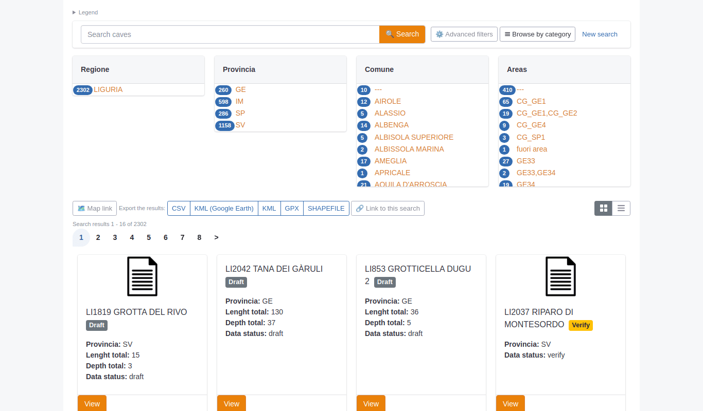

*Browse by category* lists regions, provinces, municipalities and karst areas with the number
of caves: a click filters the list.

### Links and exports

Below the search box:

- **Map link** opens the map with only the caves found;
- **Export the results**: CSV, KML (Google Earth), KML, GPX, SHAPEFILE (see
  [Exporting data](#7-exporting-data));
- **Link to this search** is an address to bookmark or send that repeats the same search.

At the bottom of the list, **Download insertion form** downloads a form that can be filled
in offline to propose a new cave (see
[Proposing data without an account](#proposing-data-without-an-account)).

---

## 4. The cave sheet

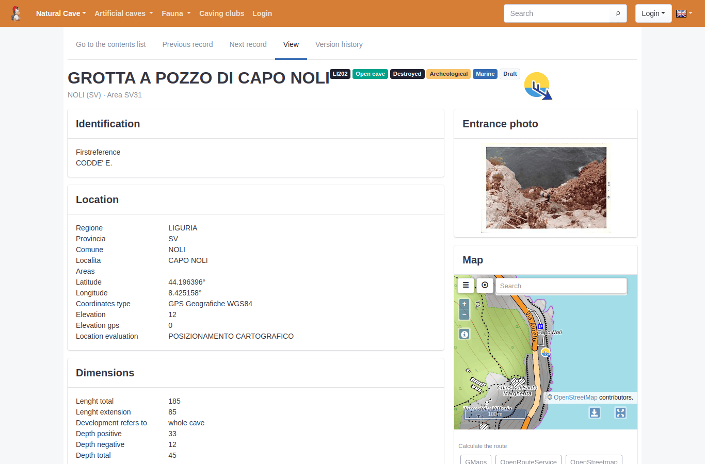

At the top are the **navigation tabs**: *Go to the contents list*, *Previous record*, *Next
record*, *View* and, for users with the rights, *Version history*, *Modify* and *Edit
qualified users to modify*.

The title shows name, municipality, province and karst area, with badges for the register
number and the main features: open or closed, destroyed, show cave, archaeological, marine,
data status. The icon on the right is the symbol of the cave on the map.

### Data boxes

In the left column the data are grouped in boxes: *Identification*, *Location*,
*Dimensions*, *Characteristics*, *Description* (description, access route, sequence of
shafts), *Fauna*, *Geology*, *History*, *Groups and chronology*, *Sheet data* (who entered
and updated the record and when, data status). Empty fields are not shown.

### Map and coordinates

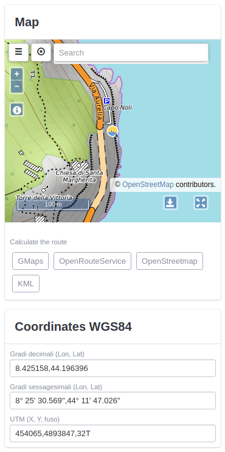

In the right column:

- **Entrance photo**;
- **Map** centred on the entrance, with the *coordinate history* layer showing the previous
  positions if the coordinates were corrected;
- **Calculate the route** with Google Maps, OpenRouteService or OpenStreetMap, and **KML** to
  download the entrance (for Google Earth or a GPS);
- **Coordinates WGS84** in decimal degrees, in degrees-minutes-seconds and in UTM with zone:
  a click in the field selects the value for copying.

OpenKIS calculates the WGS84 coordinates from the coordinates entered and their reference
system (see [Coordinates](#coordinates)).

### 3D models, register sheet, Grottocenter

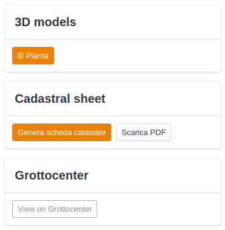

- **3D models**: one button for each survey with a `.lox` file (Therion) opens the 3D
  viewer; `.las` point clouds open in their own viewer.
- **Cadastral sheet** (Liguria): *Genera scheda catastale* opens the sheet in the format of
  the Italian cave register, ready to print; *Scarica PDF* downloads it as an A4 PDF.
- **Grottocenter**: appears when the cave is linked to the same cave on Grottocenter; *View
  on Grottocenter* opens its page (see [Grottocenter](#8-grottocenter)).

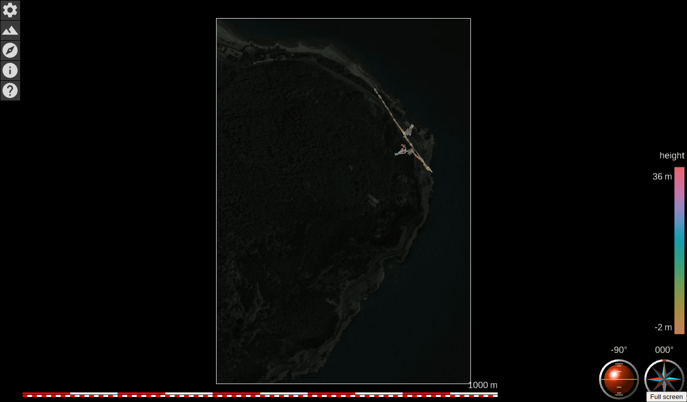

In the 3D viewer (CaveView) drag to rotate the model and use the wheel to zoom; the buttons
on the left change view, colours, terrain and information.

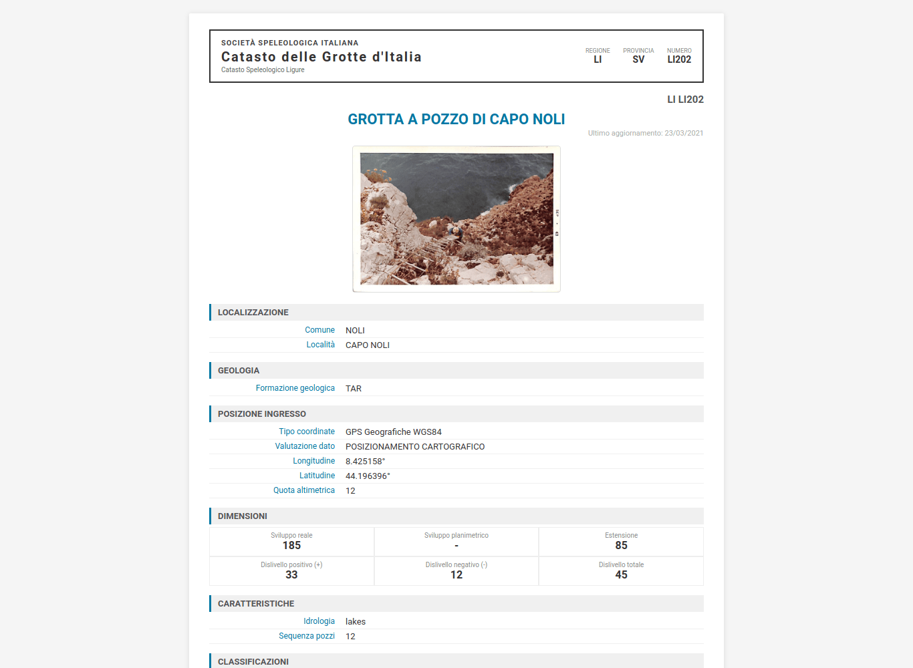

### Surveys, photos, bibliography

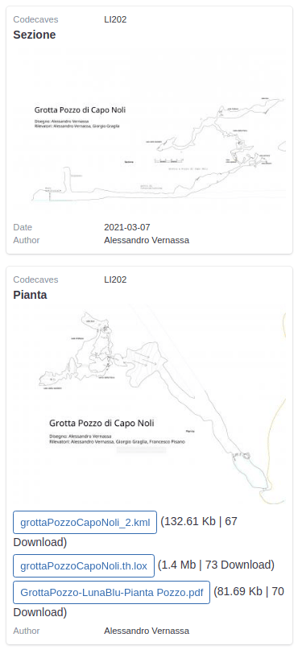

- **Surveys**: for each survey the preview, date, author and attached files (KML plan,
  Therion survey, PDF, ...) with size and number of downloads.
- **Photos**: the photos with title, date and author.
- **Fauna surveys** and **Attachments**, when present.
- **Bibliography**: the publications that mention the cave, with year, title and authors;
  *View* opens the record of the publication.
- **Tracer tests** where the cave is the injection or detection point, with a link to the
  map.
- **Temperatures**: the spot measurements and monitorings of the temperature in the cave,
  with the reading or the mean of the series and a link to the map.

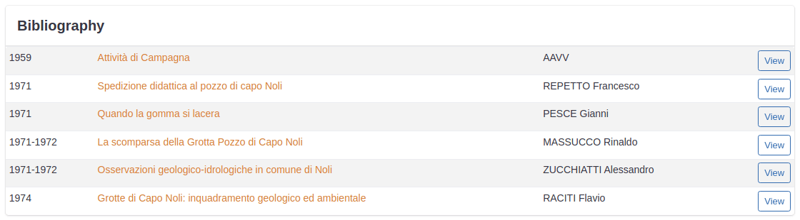

In Liguria the sheet also shows the historic sheets of the G.S.L. Issel register and, for
curators, the documents of the Delegazione Speleologica Ligure.

At the bottom, **Download update form** downloads the offline form already filled with the
data of the cave, to correct and send to the register.

### Version history

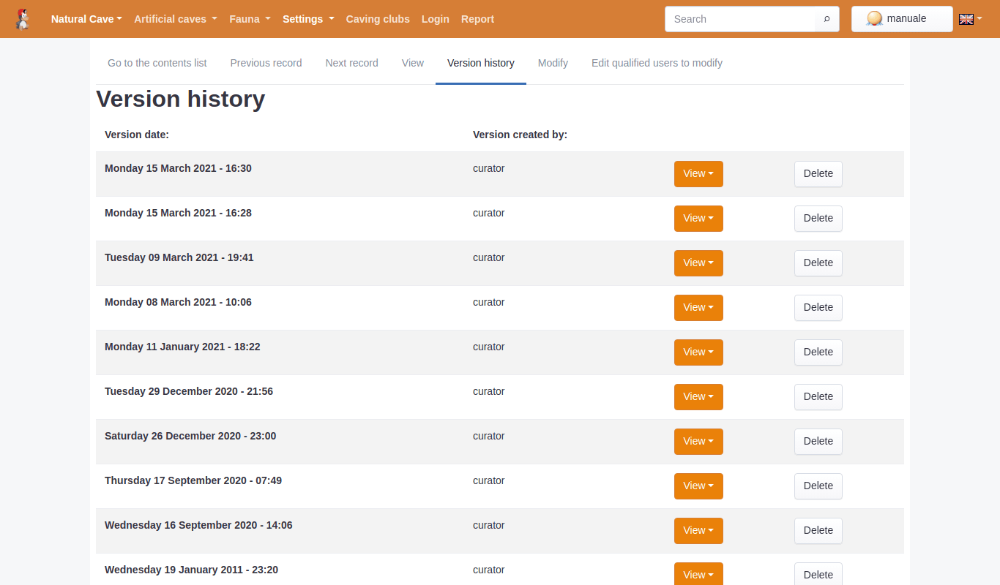

At every save OpenKIS keeps the previous version of the record, files included. *Version
history* (for the register administrators) lists the versions with date and author: *View*
opens the record as it was, *Delete* removes that version. There is no restore button: to
go back to an earlier value, copy it from the old version into the current record.

---

## 5. Adding and editing records

### Who can edit

A record can be edited by:

- the site administrators;
- the members of the group that manages the archive (for caves usually `w_caves`);
- the user who created the record;
- the users added in *Edit qualified users to modify*.

Who can add new records is decided by the administrator (usually the same `w_caves`
group). Everybody else can use the offline form (see below).

### New record

At the bottom of the list, **Add new** opens an empty form (country and region are already
filled in). In Liguria, if the **Code** field is left empty, a free number with the `LI`
prefix is assigned when the record is saved.

After saving, surveys, photos, fauna surveys and attachments are added on the same page.

### The edit form

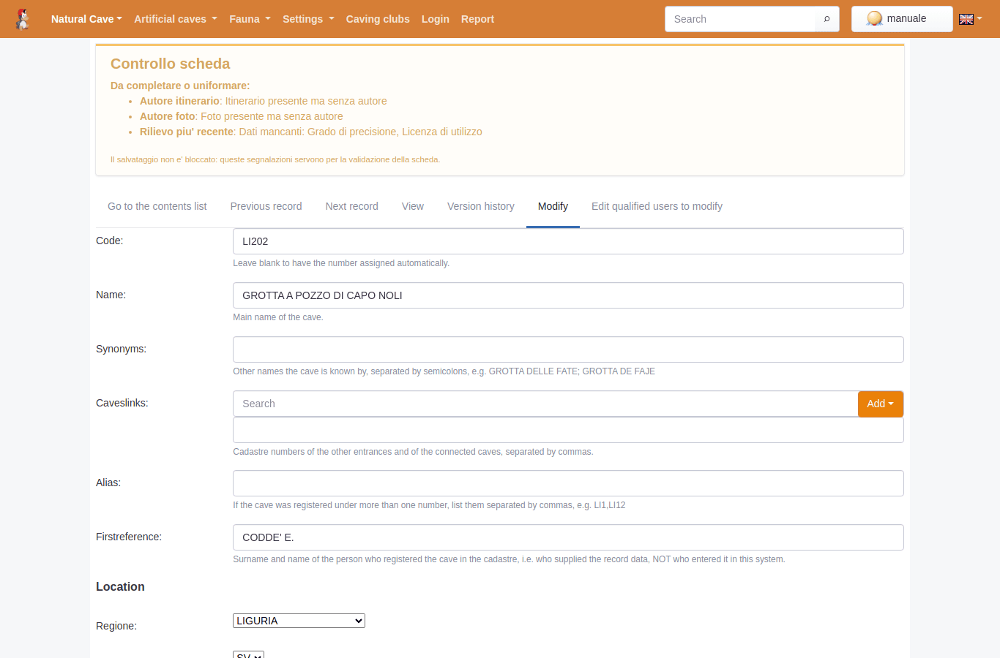

The **Controllo scheda** (record check) box at the top lists missing or inconsistent data
according to the rules of the register (for example an access route without author, a
survey without licence). These are warnings: saving is not blocked.

Each field has a short help text below it. The fields are grouped:

- **Identification**: *Code*, *Name*, *Synonyms* (other names, separated by semicolons),
  linked caves (other entrances and connected caves: search the cave and press *Add*),
  *Alias* (former register numbers), first reference (who first registered the cave).
- **Location**: *Region*, *Province* and *Municipality* (each list depends on the previous
  one), locality, mountain, valley, karst area, geological formation, lithology.
- **Dimensions**: real length, planimetric length, extension, *Development refers to* (whole
  cave or only the branch of this entrance), positive, negative and total depth, in metres.
- **Entrance location**: coordinates, elevations, map and reliability of the position (see
  below).
- **References to special censuses**: archaeological, marine, lake cave, environmental risk,
  show cave, closed cave (with access notes), destroyed cave, position checked in the field.
- **Description**: hydrology, trend, practicability, groups, register chronology, notes,
  description, access route, sequence of shafts, fauna, meteorology, geology, history.
- **Entrance image** and **authors** of the texts and of the photo.
- **Notes on this version of the record**: one line explaining the change; it stays in the
  history.

*Save* stores the record, *Cancel* leaves without saving.

### Coordinates

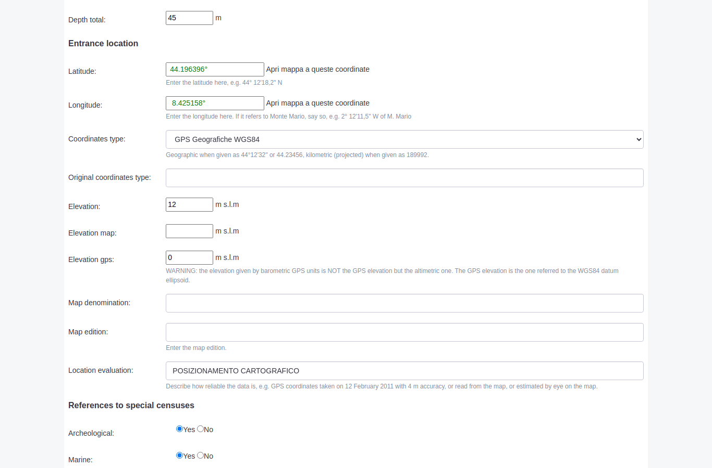

Enter the coordinates as they were measured and choose the matching **Coordinates type**
(WGS84, ED50, Rome 1940/Monte Mario, Gauss-Boaga, UTM, ...):

- geographic coordinates in degrees-minutes-seconds (`44°12'18,2'' N`) or decimal degrees
  (`44.196396`); for longitudes referred to Monte Mario write `W di M. Mario`;
- projected coordinates (Gauss-Boaga, UTM) in metres, e.g. `1489992`.

OpenKIS calculates the WGS84 coordinates for maps and exports. The link **Apri mappa a
queste coordinate** (open map at these coordinates) shows at once where the point falls
with the chosen type, which reveals a wrong reference system:

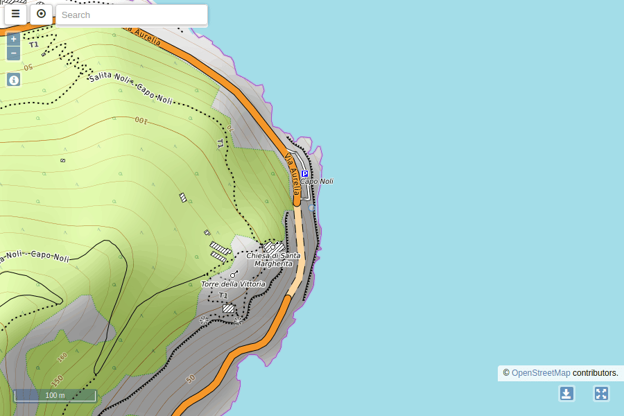

There are three elevations: *Elevation* (from the map or an altimeter), *Elevation map* and
*Elevation GPS*. Note that the elevation of non-barometric GPS receivers refers to the WGS84
ellipsoid, not to sea level. *Location evaluation* describes how reliable the position is
(e.g. "GPS 12 February 2011, accuracy 4 m" or "map positioning").

### Visibility and data status

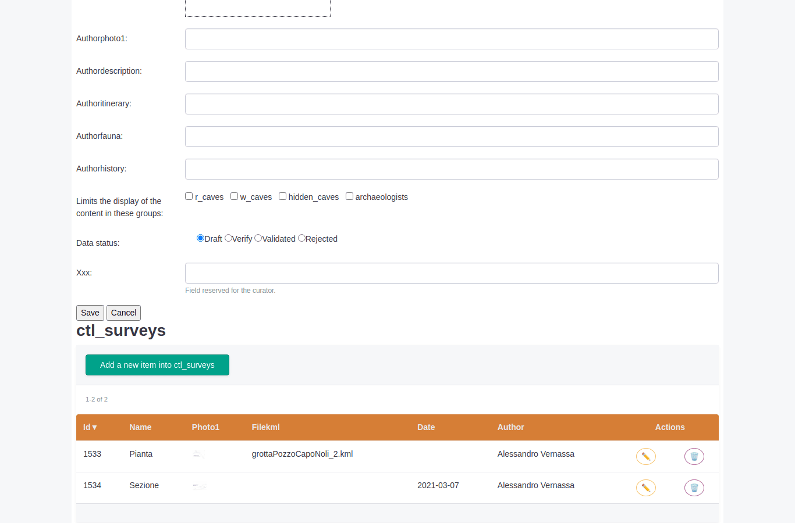

- **limits the display of the content in these groups**: with no group chosen the record is
  visible to everyone who can see the archive; choosing one or more groups (e.g.
  `hidden_caves` for a cave to protect, `archaeologists` for an archaeological site) only
  those groups, the curators and the administrators see it. Restricted records also
  disappear from lists, maps and exports.
- **Data status**: *Draft*, *Verify*, *Validated*, *Rejected*; it appears as a badge in the
  list and on the sheet.
- **Curator date**: a field reserved to the curator.

Below the form, the **Surveys**, **Photos**, **Fauna surveys** and **Attachments** tables
have an *Add a new item* button and, on each row, icons to edit or delete it. Each survey
has image, source file, KML, PDF, Therion file (`.lox`) or point cloud (`.las`), date,
authors, licence and accuracy.

In Liguria the form also has a quick photo upload and, when configured, a button that has
the survey drawing analysed by an artificial intelligence service.

### Users allowed to edit

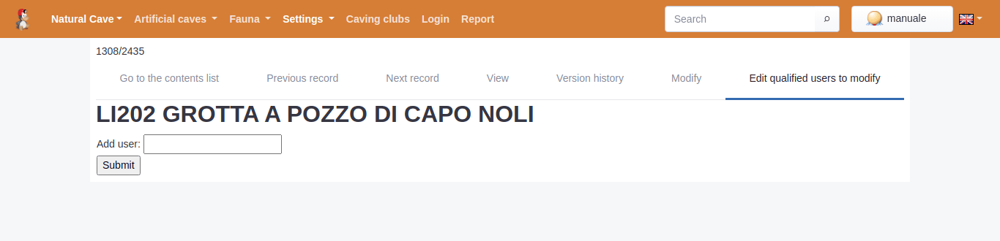

*Edit qualified users to modify* adds or removes single users who may edit that record
without being in the curators' group. The creator of a record is added automatically.

### Deleting a record

If the administrator has enabled deletion, whoever manages the record sees a button to
delete it, with a confirmation page. Usually the record is only hidden, not removed from the
database.

### Proposing data without an account

People who cannot edit the register can still propose data:

- **Download insertion form** (at the bottom of the list) downloads an empty form for a new
  cave;
- **Download update form** (at the bottom of a cave sheet) downloads the form filled with
  its data.

The form is an HTML page that opens in the browser even offline. Once filled in it can be
*sent by email* to the register, *saved to disk* or, with an account, *opened in the site
with these data*.

---

## 6. The other archives

All archives work like the caves archive: list with search, filters and categories, sheet,
edit form, history (where enabled) and exports.

| Archive | Menu | Content |
| --- | --- | --- |
| Artificial cavities | Artificial caves | Mines, tunnels, bunkers, aqueducts, ... with surveys, photos and attachments; groups `r_artificials`/`w_artificials` |
| Karst springs | Natural Cave | Springs with position, flow and water use; they can be the detection point of a tracer test |
| Tracer tests | Natural Cave | Tests with tracers (water or air): injection point, detection point (a cave, a spring, or free coordinates for a point that is not an entrance), tracer, date, result; above the list a map with the arrows of the positive tests |
| Temperatures | Natural Cave | Underground temperature measurements after the sheets of the UCC project: spot readings and data logger monitorings of the air, water or rock, with position, conditions, instrument and source; map of the points coloured by temperature; CSV export in the layout of the UCC sheets (see [TEMPERATURES.md](TEMPERATURES.md)) |
| Speleological areas | Natural Cave | The karst areas; the sheet of an area lists its caves |
| Cave systems | Natural Cave | Systems of several caves; the length can be recalculated from the member caves |
| Surveys | Natural Cave | All surveys, also those of cave systems |
| Bibliography | Natural Cave | Publications with authors, year, journal, abstract and files; linked to caves, artificial cavities and fauna |
| Cave fauna | Fauna | The species (taxonomy, photos); groups `r_fauna`/`w_fauna` |
| Fauna surveys | Fauna | Observations of a species in a cave or artificial cavity |
| Glacial speleology | Glacial speleology (where enabled) | Glacial caves, their surveys and glaciers |
| Caving clubs | Caving clubs | The clubs with logo, province, whether active and their journal |

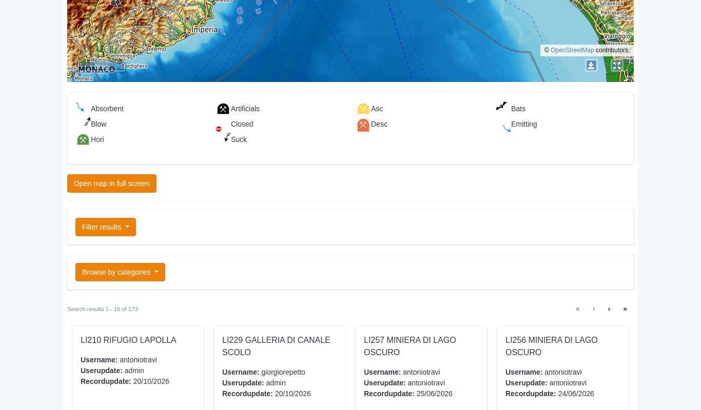

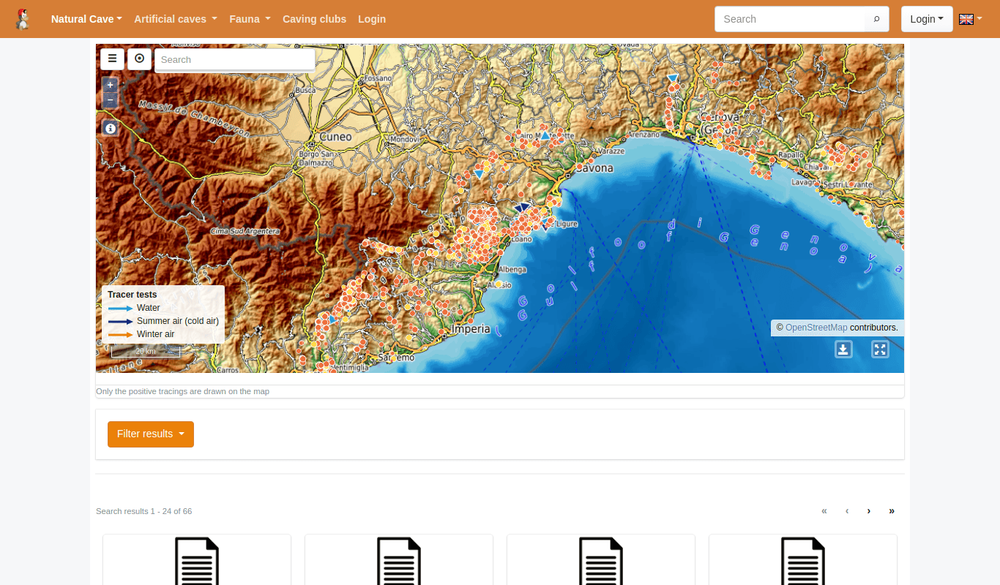

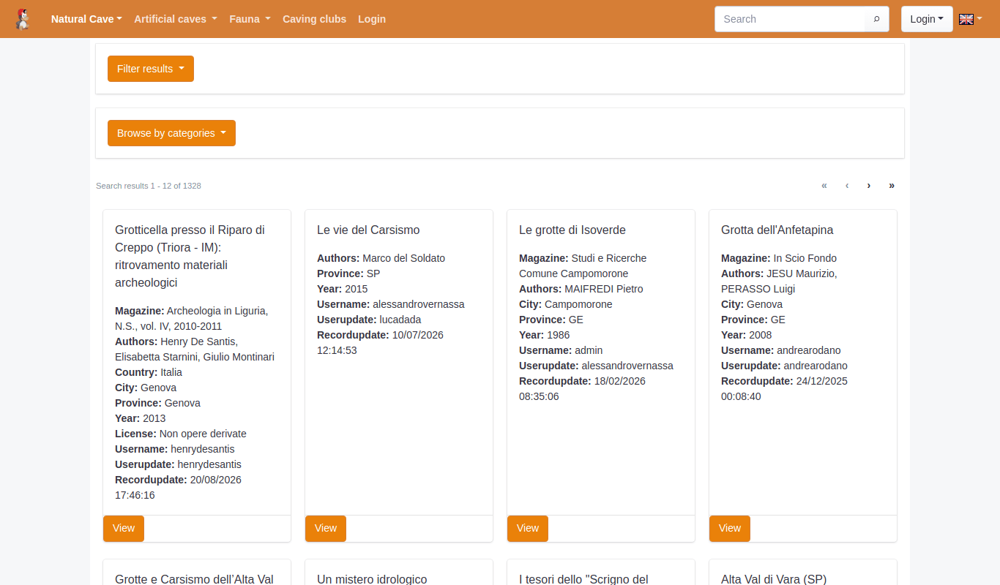

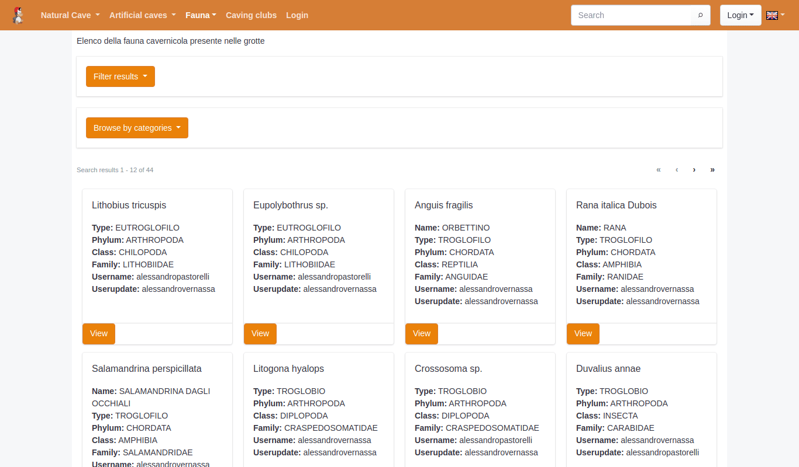

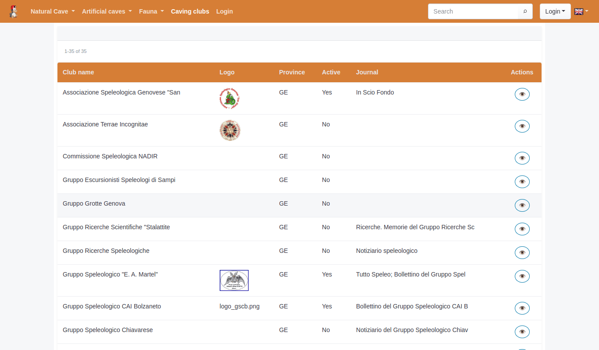

---

## 7. Exporting data

Exports contain only the records the user can see, and only those with valid coordinates.
From the caves list they export all the search results, not only the page shown.

| Format | Where | Use |
| --- | --- | --- |
| CSV | List, *Export the results* | Spreadsheet with the fields of the record |
| KML (Google Earth) | List | For Google Earth: icons with full address |
| KML | List, map of the sheet | GIS, GPS, navigation apps |
| GPX | List | GPS; each point also carries the original coordinates and their type |
| SHAPEFILE | List | GIS (QGIS, ArcGIS): ZIP with 3D points and the main fields, WGS84 coordinates |
| Karstlink (CSV, JSON-LD) | `openkis_karstlink.php` | Data exchange with Grottocenter and other databases (see below) |
| Report CSV | *Report* | Completeness of the records (see [Report](#report)) |

The export addresses accept the same filters as the list, for example
`openkis_kml.php?mod=caves&filter_code=LI202` exports a single cave.

---

## 8. Grottocenter

[Grottocenter](https://grottocenter.org) is the collaborative database of the caves of the
world. It already holds many Italian caves, often imported years ago from the regional
registers: same coordinates, but without register number and sometimes with truncated names.

OpenKIS does two things:

1. it **exports** the public caves in the **Karstlink** format, the data exchange standard of
   the UIS that Grottocenter can import;
2. it **links** each cave of the register to the same cave on Grottocenter: the search
   proposes the links, the curator confirms them and the link appears on the cave sheet.

Nothing is written to Grottocenter: OpenKIS only reads its public API, without an account.

The page is **Settings > Grottocenter** and is reserved to the administrators of the caves
archive (e.g. `w_caves`) and of the site.

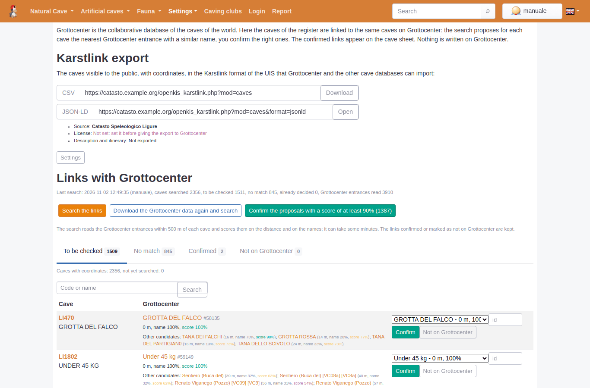

### Karstlink export

The top of the page shows the two addresses of the export:

```text
https://<site>/openkis_karstlink.php?mod=caves                  CSV
https://<site>/openkis_karstlink.php?mod=caves&format=jsonld    JSON-LD
```

- It contains the caves a visitor can see, with valid coordinates.
- For each cave: register number and other names (in `gn:alternateName`), WGS84
  coordinates, elevation, accuracy of the position, length, depths, whether it is a show
  cave or closed, the address of the sheet as source and, once confirmed, the matching
  Grottocenter entrance (`owl:sameAs`).
- Below the addresses the settings are summarised: **source** (the name of the register),
  **licence** of the data, whether description and access route are exported.

Before handing the export to Grottocenter, a site administrator must choose the licence in
**Settings** (Grottocenter does not import data without a licence).

### Searching the links

**Search the links** reads from Grottocenter the entrances near each cave and proposes for
each one the most likely entrance; it can take a few minutes. The downloaded Grottocenter
data stay valid for some hours (24 by default): **Download the Grottocenter data again and
search** refreshes them before the search. In Liguria the search examined 2,356 caves and
3,910 Grottocenter entrances and proposed 1,511 links, 1,389 of them scoring at least 90%.

A new search keeps the links already confirmed or marked as missing and only replaces the
proposals.

### The score

Each entrance within the maximum distance (500 m) gets a score from 0 to 100% that combines:

- **the name**: the words that identify the cave are compared, ignoring generic words
  (*grotta*, *tana*, *arma*, *buranco*, *pozzo*, ...) and articles; truncated or differently
  spelled names still count; a register number inside the Grottocenter name (e.g.
  `[LI1878]`) counts as the same name;
- **the distance**: a few metres alone are worth almost 90%, 100 m less than 20%.

One of the two is enough for a high score: the same name a few hundred metres away, or a
truncated name a few metres away. Each Grottocenter entrance is proposed for one cave only,
the one with the best score. Below 40% the cave goes to *No match*.

### Checking the proposals

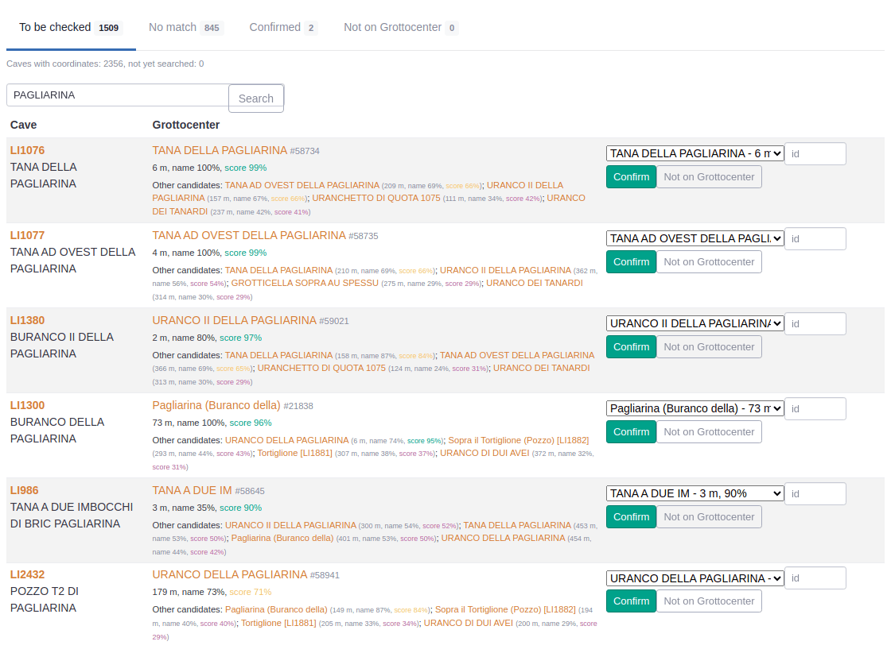

The caves are split into four tabs: **To be checked**, **No match**, **Confirmed**, **Not on
Grottocenter**, with a box to search by number or name.

For each cave the row shows:

- on the left the register number and name (link to the sheet);
- in the middle the proposed entrance (link to its Grottocenter page) with its number,
  distance, name similarity and score, and below it the **other candidates**;
- on the right the actions:
  - **Confirm** stores the link with the candidate chosen in the drop-down list;
  - the **id** box takes the number of another Grottocenter entrance (it is in the address
    of its page, `grottocenter.org/ui/entrances/<id>`); a warning appears if it is far from
    the cave;
  - **Not on Grottocenter** marks that the cave is missing there.

In the example, the *Buranco della Pagliarina* (LI1300) has two candidates: *Pagliarina
(Buranco della)* 73 m away, with the full name, and *URANCO DELLA PAGLIARINA* 6 m away, a
copy with a truncated name imported years ago. Both are plausible: the curator picks the
right one in the list before confirming.

**Confirm the proposals with a score of at least 90%** confirms in one go all the proposals
above the threshold (the number in brackets says how many). Check a sample first, then go
through the ones below the threshold one by one.

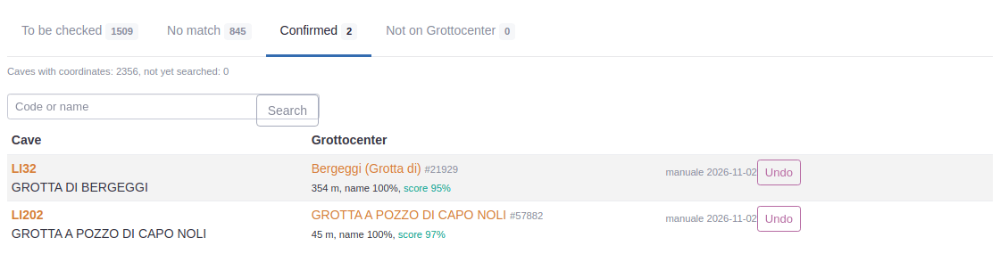

In the *Confirmed* tab each row shows who confirmed it and when; **Undo** removes the link,
which the next search will propose again.

Confirmed links appear on the cave sheet (*Grottocenter* box, *View on Grottocenter* button)
and in the Karstlink export.

### Settings

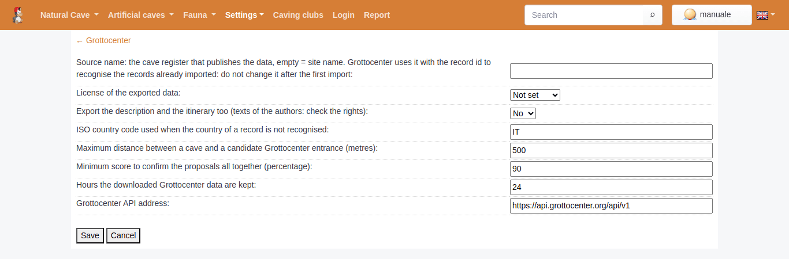

The settings change the public export, so only site administrators can edit them.

| Setting | Default | Notes |
| --- | --- | --- |
| Source name | site name | Grottocenter uses it with the record id to recognise records already imported: do not change it after the first import |
| Licence of the exported data | not set | CC-BY, CC-BY-SA, ODbL, ODC-By; required for the import |
| Also export description and access route | no | They are texts of their authors: check the rights first |
| ISO country code | IT | Used when the country of the record is not recognised |
| Maximum distance | 500 m | Farther candidates are ignored |
| Minimum score for confirming together | 90% | |
| Hours of validity of the downloaded data | 24 | |
| API address | `https://api.grottocenter.org/api/v1` | |

### Not done yet

Sending the missing caves to Grottocenter is not automatic: it needs a Grottocenter account
allowed to import, an agreement with the Grottocenter team and a licence for the data. The
Karstlink file is already in the format of their importer. Technical details in
[GROTTOCENTER.md](GROTTOCENTER.md).

---

## 9. AI assistants (MCP server)

An AI assistant (Claude, ChatGPT, ...) can query OpenKIS through the MCP protocol: you ask
questions in plain language ("which caves in Noli are longer than 100 m?") and, if allowed,
update records. The assistant works with the same rights the user has on the site.

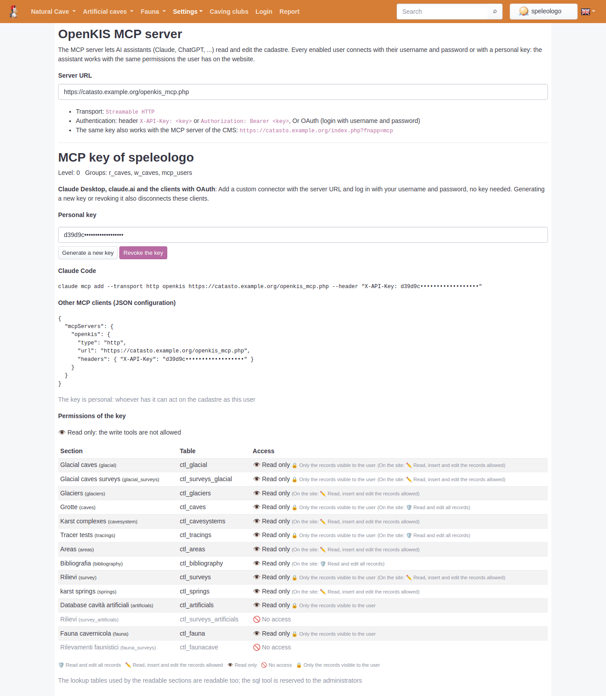

The page is **Settings > MCP server**:

- an administrator **enables** the user (group `mcp_users`); access is **read only** by
  default, writing is granted separately (group `mcp_write`);
- the enabled user sees the server address, generates a **personal key** and finds the
  command for Claude Code and the JSON configuration for other clients;
- Claude Desktop, claude.ai and the other OAuth clients do not need the key: add the server
  address as a connector and log in with user name and password;
- the **key permissions** table shows, archive by archive, what the key can read or change.

The key is personal: whoever holds it works on the register as that user. Generating a new
key or revoking it disconnects all clients. Details in [MCP_SERVER.md](MCP_SERVER.md).

---

## 10. Administration

This chapter is for site administrators. Installation is described in the
[README](../README.md).

### The control center

Open it from `index.php?fnapp=controlcenter` (or from the user menu). The menu on the left
contains:

- **Contents**: *Pages and structure* (the sections of the site, their order and
  permissions), blocks, files;
- **Global settings**: *Website setup* (site name, languages, theme, home page, registration,
  email), *Look and feel* (themes), and the options of each archive (*Page dbview: Grotte*,
  ...);
- **Users and groups**: users, groups, registration conditions, profile fields;
- **Utilities**: control center users, scheduled tasks, event log, mail, server
  information, *refresh map data*.

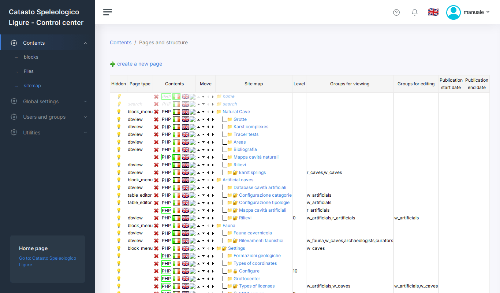

*Pages and structure* shows the tree of the sections. For each one you set: hidden or not,
type, minimum **level**, **groups allowed to view**, **groups allowed to edit** the page and
publication dates. A hidden section is not in the menu but can still be opened from its
address.

### Users and groups

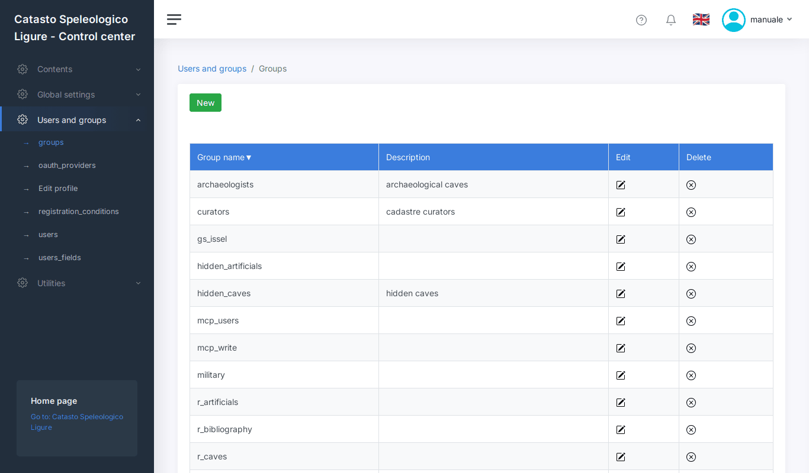

The main OpenKIS groups:

| Group | Meaning |
| --- | --- |
| `r_caves`, `r_artificials`, `r_fauna` | Read access to the restricted sections of the archive |
| `w_caves`, `w_artificials`, `w_fauna` | Add and edit records (curators) |
| `hidden_caves`, `archaeologists` | See the records restricted to those groups |
| `mcp_users`, `mcp_write` | Use of the MCP server, and with writing |

OpenKIS creates the `r_`/`w_` and `mcp_` groups; other groups are created with *New*.

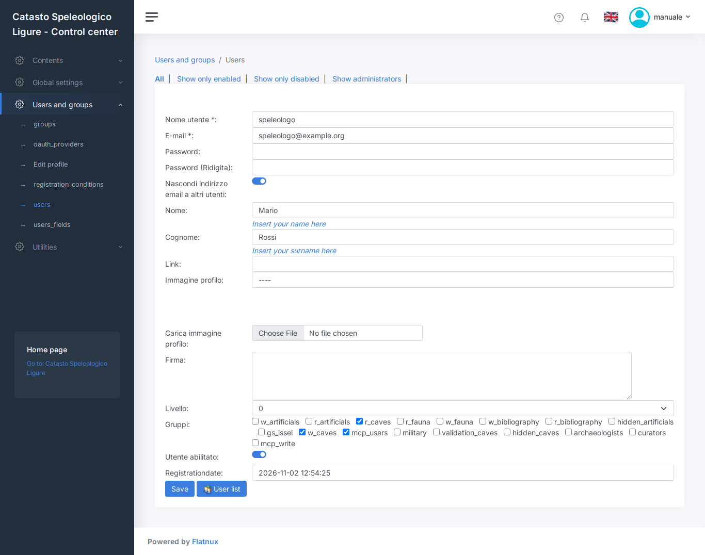

To give a user rights: **Users and groups > Users**, open the user and tick the groups.
**Level** 10 makes the user a site administrator: keep it for the people who run the site,
curators only need the groups. *User enabled* suspends or reactivates the account.

### Permissions of the archives

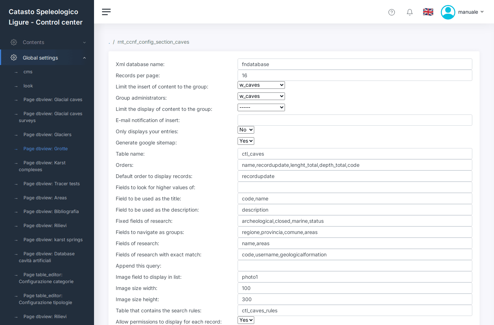

*Global settings > Page dbview: Grotte* (and the similar pages) configure the archives. The
most important options:

- **Limit the insert of content to the group** (`groupinsert`): who can add records. **If
  it is empty, any registered user can add records**: always set it (e.g. `w_caves`).
- **Group administrators** (`groupadmin`): who can edit all records and see the history.
- **Limit the display of content to the group** (`groupview`): who can read the archive;
  empty = public.
- **Allow permissions to display for each record** and the groups for record permissions:
  enable the *Limits the display* field on the records and choose the groups offered.
- search, sort order, category fields, records per page, history, exports, deletion, offline
  form, sitemap for search engines.

Site administrators can also set the visibility groups of many records at once with the
*Access control* page at the bottom of the list.

### Website setup and themes

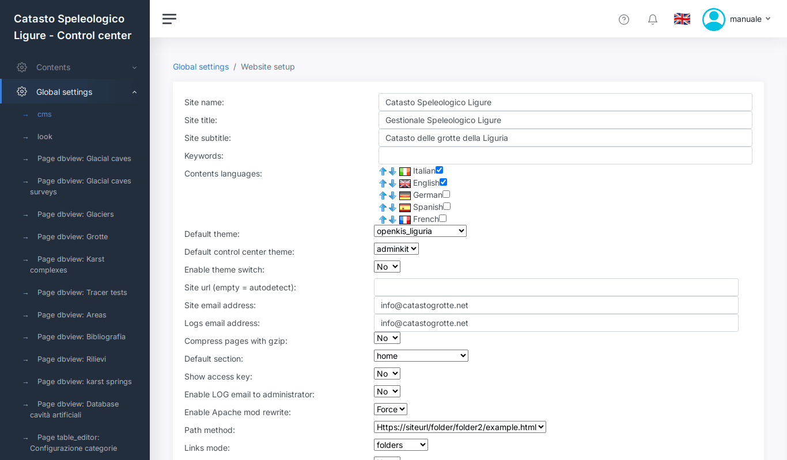

*Website setup* holds site name and title, languages, theme, home page, site email, user
registration (open, with email confirmation, captcha) and addresses.

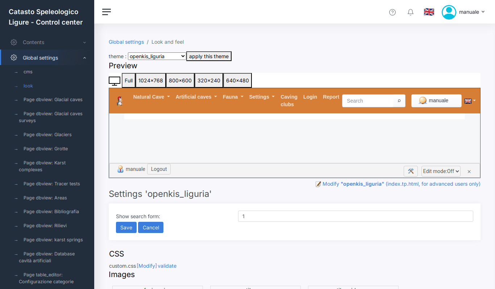

*Look and feel* previews the themes, applies the chosen one and edits its options and CSS.
OpenKIS has the base theme `openkis`, the regional variants (`openkis_liguria`,
`openkis_lombardia`, `openkis_umbria`, `openkis_wish`) and
`openkis_grottocenter`, which follows the look of grottocenter.org; `openkis_fslo` and
`openkis_agsp` use the same layout with the logo and colours of the Lombard and of the
Piedmontese cadastre. The options of a theme
are copied into the database the first time it is used: later changes to the theme's
`config.php` do not change a site already installed, make them from this page.

### OpenKIS configuration

In the site's *Settings* menu:

- **Configure**: initial centre and zoom of the map;

  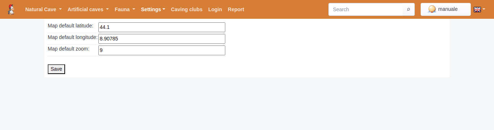

- **Types of coordinates**: the reference systems accepted on the records, each with the
  proj4 definition used for the conversion to WGS84;

  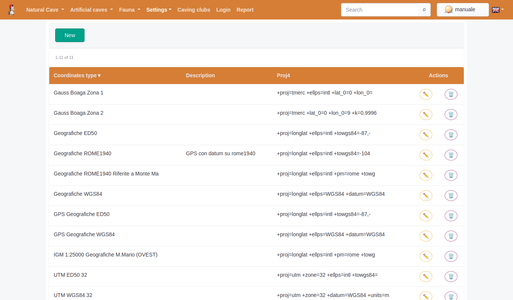

- **Formazioni geologiche** (geological formations) and **Types of licenses**: tables used
  in the forms;
- **Grottocenter** and **MCP server**: see the previous chapters.

*Types of coordinates* and *Geological formations* are shared by all records and anyone who
opens the page can edit them: restrict access to curators or administrators with the
*level* or the *groups allowed to view* in *Pages and structure*.

### Report

*Report* lists for each cave surveys, photos, description, access route, position, last
update, visibility and data status, and exports it all as CSV: it helps plan the curators'
work. The report shows **all** caves, restricted ones included: allow only the curators to
view the section with its *groups allowed to view*.

### Regional customisation

The file `extra/openkis_config.local.php` names the register with `$_FN['openkis_custom']`
(e.g. `liguria`). The folder `extra/openkis/custom/<region>/` can hold:

- automatic numbering of the records and default values of the new forms;
- the default centre of the map;
- the boxes of the sheet (`viewfooter_caves.php`: coordinates in several formats, PDF
  register sheet, historic documents);
- the rules of the record check (`validator_caves.php`);
- a custom offline form;
- the map layers (`bs_map/conf/layers_<region>.js`).

The `custom/example` folder is the template to copy for a new register.

### Maintenance

- **Refresh map data** (*Utilities*): recalculates the coordinates and clears the cache of
  maps and exports. It is needed only after changes made directly in the database; changes
  made through the site refresh the cache by themselves.
- **Database indexes**: `sql/openkis_indexes.sql` speeds up the pages with many records (see
  [INDEXES.md](../INDEXES.md)); run it again after updates.
- **Backup**: save the MySQL database, the `misc/` folder (table definitions, settings and
  all uploaded files: photos, surveys, attachments) and `extra/openkis_config.local.php`.
- **Updates**: update the code (`git pull` and `git submodule update`), then run the indexes
  again. Sites older than 2024-03-25 also need the SQL in `extra/openkis/update.md`.

---

## 11. Glossary

| Term | Meaning |
| --- | --- |
| Catasto (cave register) | Official register of the caves of a region; each cave has a number (e.g. LI202) |
| Scheda (record, sheet) | The record of a cave (or of a spring, a survey, ...) |
| Sviluppo reale (real length) | Sum of the lengths of all passages, measured in three dimensions |
| Sviluppo planimetrico (planimetric length) | Sum of the lengths projected on the horizontal plane |
| Estensione (extension) | Maximum distance in plan between two points of the cave |
| Dislivello (depth) | Height difference from the entrance, positive (above) and negative (below) |
| Rilievo (survey) | The topographic drawing of the cave (plan, section), with its survey files |
| Tracciamento (tracer test) | Test with a tracer to follow the path of water or air |
| Curatore (curator) | Who manages the records of a province or an archive |
| Karstlink | UIS standard for exchanging cave data |
| Grottocenter | Collaborative world database of caves |
| MCP | Model Context Protocol, the protocol AI assistants use to call external tools |
