# Manuale di OpenKIS

OpenKIS (Opensource Karst Information System) è il software con cui i catasti speleologici
pubblicano e gestiscono via web i dati di grotte, cavità artificiali, sorgenti carsiche,
tracciamenti, fauna, ghiacciai e bibliografia. Questo manuale spiega come consultare il
catasto, come inserire e aggiornare le schede, come collegare il catasto a
[Grottocenter](https://grottocenter.org) e come amministrare il sito.

Le schermate sono state fatte su una copia locale del **Catasto Speleologico Ligure** (dati
reali, tema `openkis_liguria`). Gli altri catasti usano lo stesso software, ma menu, campi,
mappe e colori possono essere diversi: alcune funzioni (scheda catastale in PDF, numerazione
automatica, mappe regionali) sono personalizzazioni della Liguria e sono indicate come tali.

English version: [MANUAL.md](MANUAL.md).

## Indice

1. [Primi passi](#1-primi-passi)
2. [La mappa](#2-la-mappa)
3. [Cercare le grotte](#3-cercare-le-grotte)
4. [La scheda della grotta](#4-la-scheda-della-grotta)
5. [Inserire e modificare le schede](#5-inserire-e-modificare-le-schede)
6. [Gli altri archivi](#6-gli-altri-archivi)
7. [Esportare i dati](#7-esportare-i-dati)
8. [Grottocenter](#8-grottocenter)
9. [Assistenti AI (server MCP)](#9-assistenti-ai-server-mcp)
10. [Amministrazione](#10-amministrazione)
11. [Glossario](#11-glossario)

---

## 1. Primi passi

### La pagina iniziale e il menu

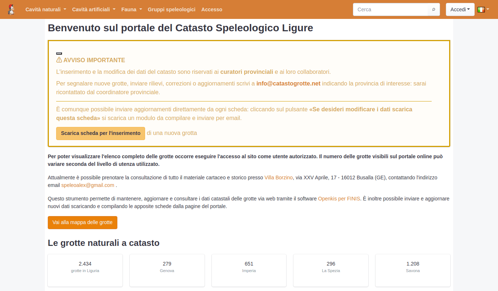

La barra in alto contiene:

- il **menu** con gli archivi: *Cavità naturali* (grotte, mappa, rilievi, aree, complessi
  carsici, tracciamenti, sorgenti, bibliografia), *Cavità artificiali*, *Fauna*, *Gruppi
  speleologici*; dopo l'accesso compaiono anche *Configurazione* e *Report*, se l'utente ha i
  permessi;
- la casella **Cerca**, che cerca in tutto il sito;
- il pulsante **Accedi** (o il nome dell'utente collegato);
- la **bandiera** per cambiare lingua (italiano, inglese, ... secondo le lingue attivate).

Il contenuto della pagina iniziale lo decide ogni catasto: in Liguria spiega chi può
modificare i dati, come inviare segnalazioni e mostra il numero di grotte per provincia.

### Accesso

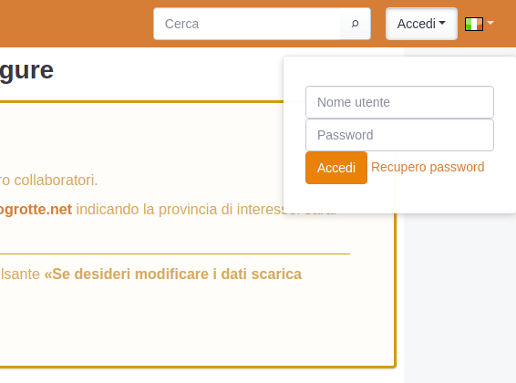

**Accedi** apre il modulo con nome utente e password; *Recupero password* invia per email
le istruzioni per sceglierne una nuova. Se l'amministratore ha aperto la registrazione,
chiunque può creare un account; altrimenti gli account li crea l'amministratore.

### Chi vede cosa

Quello che si vede dipende dal livello di accesso:

| Utente | Cosa può fare |
| --- | --- |
| Visitatore (senza accesso) | Consulta le sezioni pubbliche (in Liguria grotte, mappa, cavità artificiali, rilievi, bibliografia, fauna); non vede le schede riservate |
| Utente registrato | Come il visitatore, più le sezioni aperte agli utenti registrati |
| Lettore (`r_caves`, `r_artificials`, ...) | Vede anche le sezioni riservate in lettura (es. sorgenti carsiche) |
| Curatore (`w_caves`, `w_artificials`, `w_fauna`) | Inserisce e modifica le schede del proprio archivio |
| Gruppi speciali (`hidden_caves`, `archaeologists`, ...) | Vedono le schede riservate a quei gruppi |
| Amministratore | Tutto, compresi pannello di controllo, permessi e configurazione |

I nomi dei gruppi sono quelli predefiniti; ogni catasto può crearne altri (vedi
[Utenti e gruppi](#utenti-e-gruppi)).

Dopo l'accesso, il menu *Configurazione* raccoglie le tabelle di supporto e gli strumenti
(formazioni geologiche, tipi di coordinate, Grottocenter, tipi di licenze, server MCP):

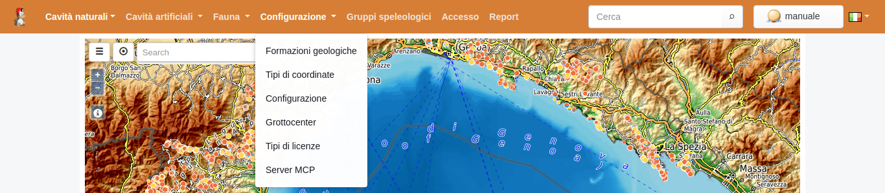

---

## 2. La mappa

*Cavità naturali > Mappa cavità naturali* mostra tutte le grotte che l'utente può vedere.
Ogni simbolo indica il tipo di grotta (assorbente, emittente, ascendente, discendente,
orizzontale, chiusa, con acqua, con pipistrelli, soffiante o aspirante): la **Legenda**
sotto la mappa li spiega. *Apri la mappa a schermo intero* la allarga a tutto lo schermo.

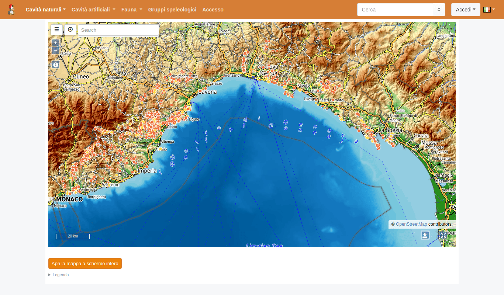

### Strumenti

| Pulsante | Funzione |
| --- | --- |
| ☰ (menu) | Sceglie la mappa di base e accende o spegne i livelli |
| ⦿ | Centra la mappa sulla posizione del dispositivo (GPS) e la segue; trascinare la mappa smette di seguirla |
| Search | Cerca una grotta per numero o nome tra quelle caricate; con `lat,lon` in gradi decimali sposta la mappa in quel punto |
| + / − | Zoom |
| (i) Info | Modalità informazioni: un clic mostra i dati senza aprire la scheda (vedi sotto) |
| ⛶ (in basso) | Schermo intero |

In basso a sinistra ci sono la scala e le coordinate WGS84 del puntatore. Sui telefoni e
sui tablet la mappa si sposta con due dita (con un dito si scorre la pagina).

### Mappe e livelli

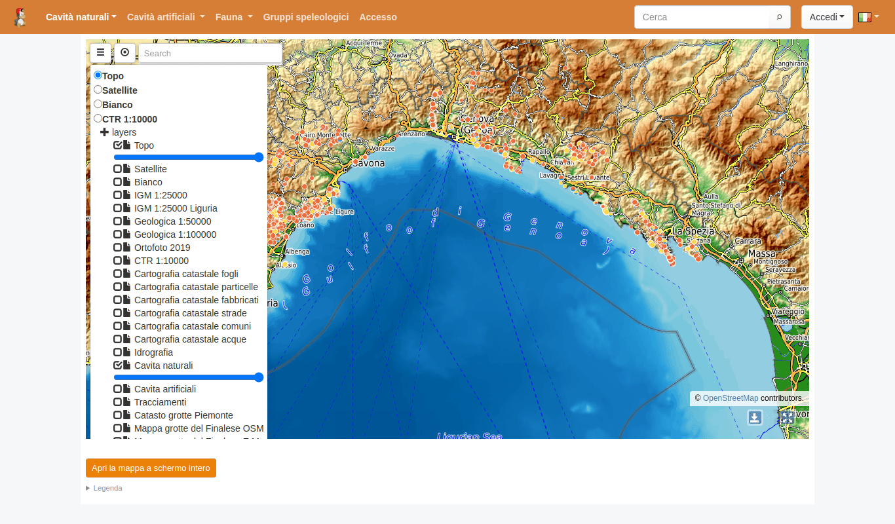

Il menu ☰ elenca le **mappe di base** (in Liguria: Topo, Satellite, Bianco, CTR 1:10000) e
i **livelli**, ognuno con la casella per accenderlo e un cursore di trasparenza:

- cartografia: IGM 1:25000, carte geologiche 1:50000 e 1:100000, ortofoto, CTR, catasto
  (fogli, particelle, fabbricati, strade), idrografia;
- dati del catasto: cavità naturali, sorgenti carsiche, cavità artificiali, tracciamenti
  (frecce dal punto di immissione al punto di rilevamento), rilievi (le piante in KML
  caricate con i rilievi);
- livelli esterni, come i catasti confinanti.

Un livello compare solo se l'utente può vedere la sezione corrispondente: per esempio le
sorgenti in Liguria sono visibili solo ai gruppi `r_caves` e `w_caves`.

### Cercare e aprire una grotta

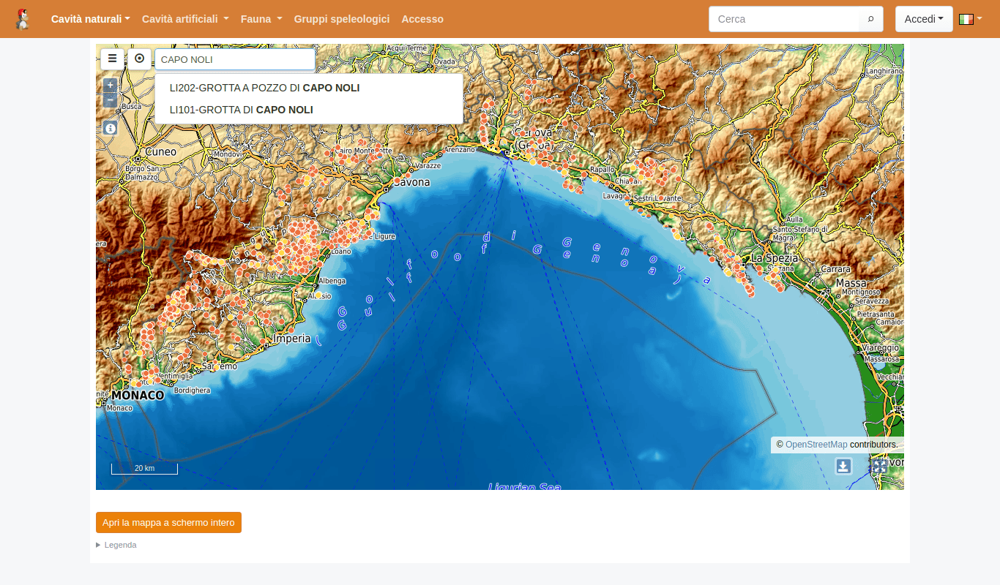

Scrivendo nella casella *Search* compaiono le grotte con quel numero o nome; sceglierne una
porta la mappa sull'ingresso. Sulla mappa principale un clic su un simbolo apre la scheda
in una nuova finestra; con la modalità **Info** attiva, invece, compare solo il riquadro
con foto, quota, sviluppo e dislivello, e i link *apri* (la scheda) e *vai a* (il percorso
su Google Maps):

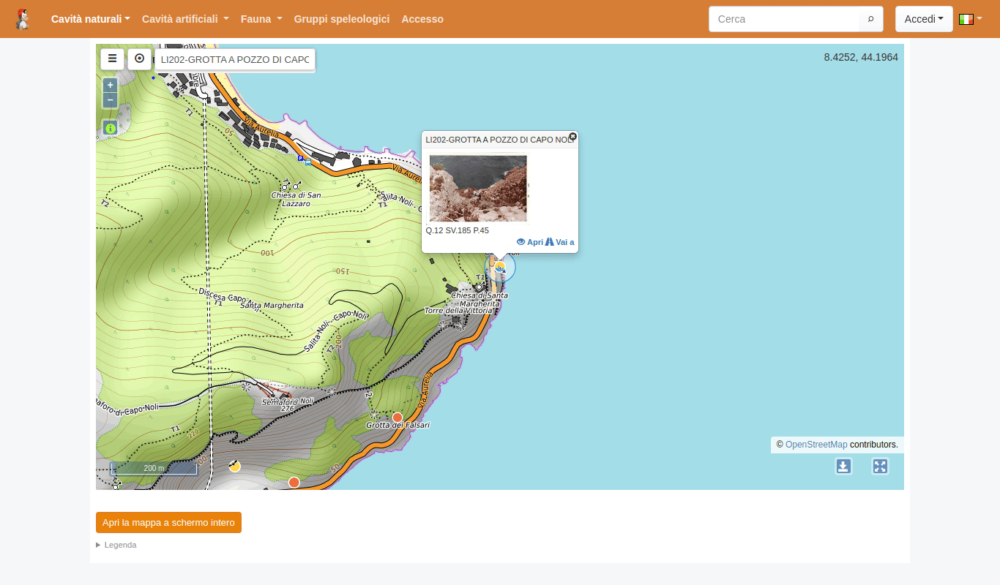

Se più simboli sono sovrapposti, il riquadro elenca i punti vicini. Con la modalità Info,
un clic in un punto vuoto mostra le coordinate (con il pulsante *Copia coordinate*),
l'indirizzo e quante grotte ci sono in quel comune e in quella provincia.

---

## 3. Cercare le grotte

*Cavità naturali > Grotte* mostra l'elenco delle schede. In alto c'è una mappa dei
risultati, che si aggiorna a ogni ricerca.

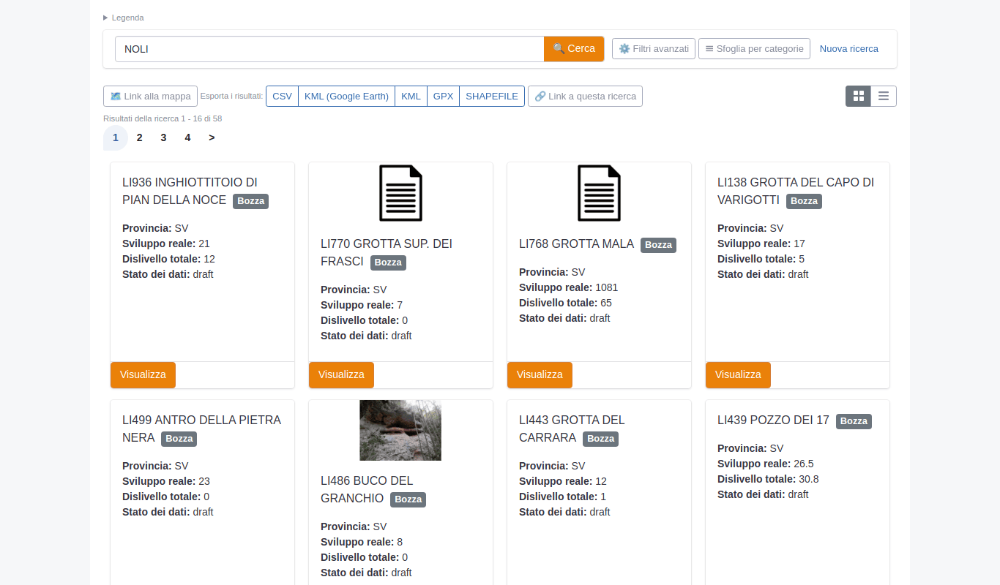

- **Ricerca libera**: la casella *Cerca per nome, codice, comune...* trova le schede in cui
  compare il testo cercato, in un campo qualsiasi (nell'esempio, *NOLI* trova le grotte del
  comune di Noli e quelle che citano Noli nei testi). Con più parole basta che ne compaia
  una: per restringere la ricerca usare i *Filtri avanzati*.
- **Nuova ricerca** azzera i filtri.
- Ogni grotta appare in un riquadro con foto dell'ingresso, numero, nome, dati principali e
  un'etichetta con lo **stato dei dati** (*Bozza*, *Da verificare*, *Validato*,
  *Rifiutato*). **Visualizza** apre la scheda.
- I pulsanti a destra passano dalla vista a schede alla vista a elenco.
- I risultati sono divisi in pagine da 16.

### Filtri avanzati

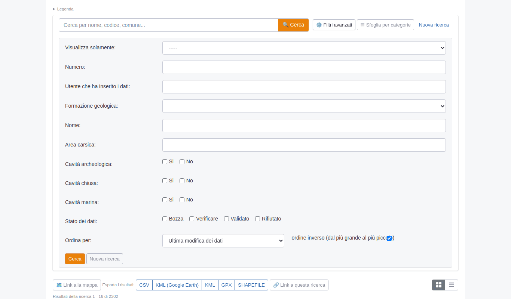

*Filtri avanzati* permette di cercare per numero, nome, area carsica, formazione geologica,
utente che ha inserito i dati, cavità archeologiche, chiuse o marine, stato dei dati, e di
scegliere l'ordinamento (nome, ultima modifica, sviluppo, dislivello) anche al contrario.
*Visualizza solamente* applica le selezioni predefinite dall'amministratore.

### Sfoglia per categorie

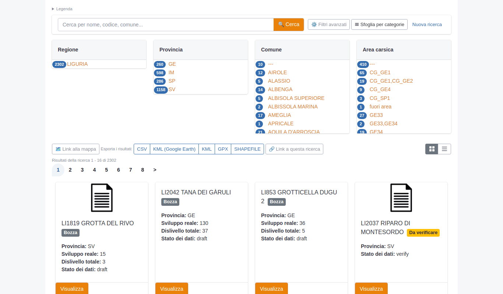

*Sfoglia per categorie* elenca regioni, province, comuni e aree carsiche con il numero di
grotte: un clic filtra l'elenco.

### Collegamenti ed esportazioni

Sotto la ricerca:

- **Link alla mappa** apre la mappa con solo le grotte trovate;
- **Esporta i risultati**: CSV, KML (Google Earth), KML, GPX, SHAPEFILE (vedi
  [Esportare i dati](#7-esportare-i-dati));
- **Link a questa ricerca** è un indirizzo da salvare o inviare che ripete la stessa
  ricerca.

In fondo all'elenco, **Scarica scheda per l'inserimento** scarica un modulo da compilare
anche senza connessione per proporre una nuova grotta (vedi
[Proporre dati senza account](#proporre-dati-senza-account)).

---

## 4. La scheda della grotta

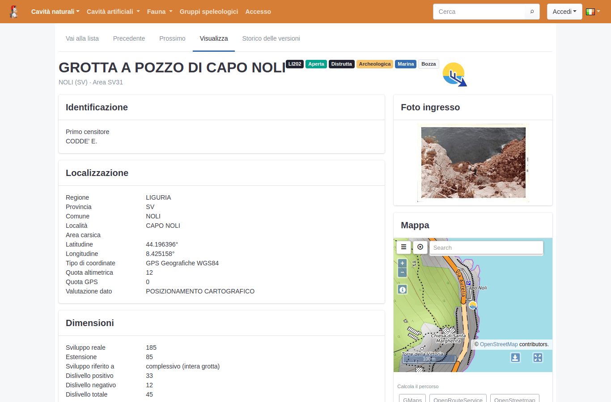

In alto ci sono le **schede di navigazione**: *Vai alla lista*, *Precedente*, *Prossimo*,
*Visualizza* e, per chi ne ha il diritto, *Storico delle versioni*, *Modifica* e *Gestisci
gli utenti abilitati alla modifica*.

Il titolo riporta nome, comune, provincia e area carsica, con le etichette del numero di
catasto e delle caratteristiche principali: aperta o chiusa, distrutta, turistica,
archeologica, marina, stato dei dati. L'icona a destra è il simbolo della grotta sulla
mappa.

### I riquadri dei dati

Nella colonna di sinistra i dati sono raggruppati in riquadri: *Identificazione*,
*Localizzazione*, *Dimensioni*, *Caratteristiche*, *Descrizione* (descrizione, itinerario,
sequenza pozzi), *Fauna*, *Geologia*, *Storia*, *Gruppi e cronologia*, *Dati scheda* (chi
ha inserito e aggiornato la scheda e quando, stato dei dati). I campi vuoti non compaiono.

### Mappa e coordinate

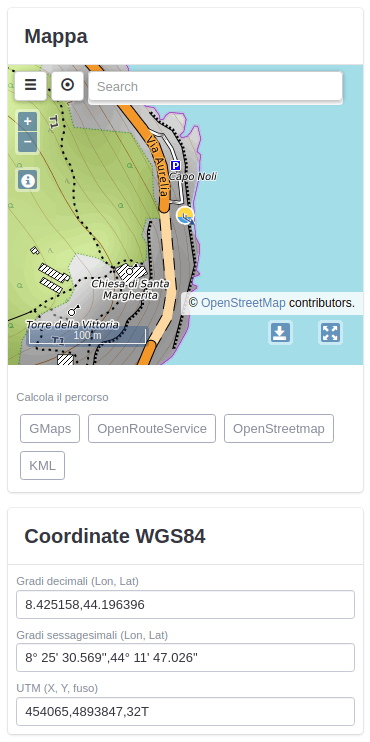

Nella colonna di destra:

- **Foto ingresso**;
- **Mappa** centrata sull'ingresso, con il livello *Storico coordinate* che mostra le
  posizioni precedenti se le coordinate sono state corrette;
- **Calcola il percorso** con Google Maps, OpenRouteService o OpenStreetMap, e **KML** per
  scaricare l'ingresso (da aprire in Google Earth o nel GPS);
- **Coordinate WGS84** in gradi decimali, in gradi sessagesimali e in UTM con fuso: un clic
  nel campo seleziona il valore da copiare.

Le coordinate WGS84 sono calcolate da OpenKIS a partire dalle coordinate inserite e dal loro
sistema di riferimento (vedi [Le coordinate](#le-coordinate)).

### Modelli 3D, scheda catastale, Grottocenter

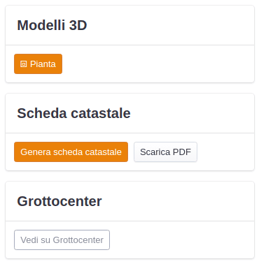

- **Modelli 3D**: un pulsante per ogni rilievo con un file `.lox` (Therion) apre il
  visualizzatore 3D; le nuvole di punti `.las` si aprono in un visualizzatore dedicato.
- **Scheda catastale** (Liguria): *Genera scheda catastale* apre la scheda nel formato del
  Catasto delle Grotte d'Italia, pronta da stampare; *Scarica PDF* la scarica in A4.
- **Grottocenter**: compare quando la grotta è collegata alla stessa grotta su
  Grottocenter; *Vedi su Grottocenter* apre la sua pagina (vedi
  [Grottocenter](#8-grottocenter)).

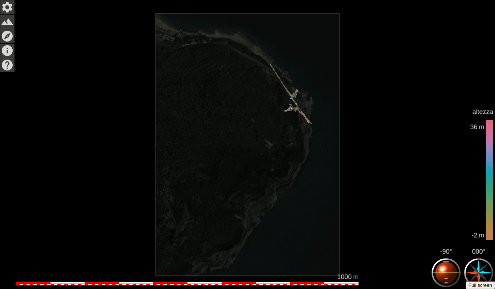

Nel visualizzatore 3D (CaveView) si ruota il modello trascinandolo, si ingrandisce con la
rotella; i pulsanti a sinistra cambiano vista, colori, terreno e informazioni.

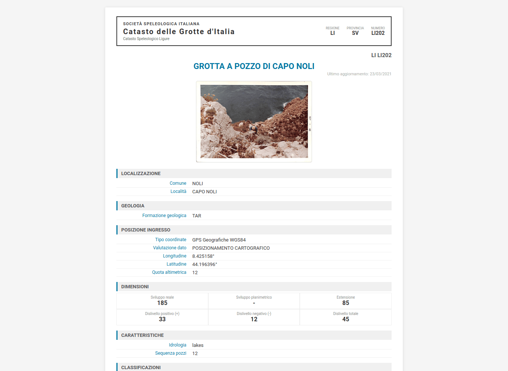

### Rilievi, foto, bibliografia

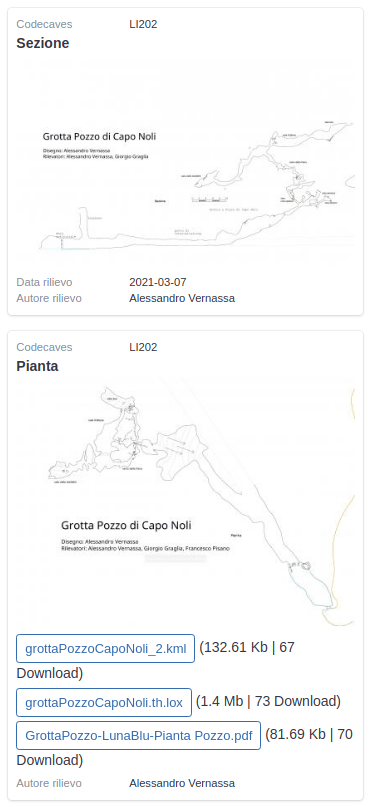

- **Rilievi cavità**: per ogni rilievo l'anteprima, la data, l'autore e i file allegati
  (pianta KML, rilievo Therion, PDF, ...) con dimensione e numero di download.
- **Foto della cavità**: le foto con titolo, data e autore.
- **Rilevamenti faunistici** e **Allegati**, quando presenti.
- **Bibliografia**: le pubblicazioni che citano la grotta, con anno, titolo e autori;
  *Visualizza* apre la scheda della pubblicazione.
- **Tracciamenti** in cui la grotta è punto di immissione o di rilevamento, con il link alla
  mappa.
- **Temperature**: le misure spot e i monitoraggi della temperatura nella grotta, con la
  lettura o la media della serie e il link alla mappa.

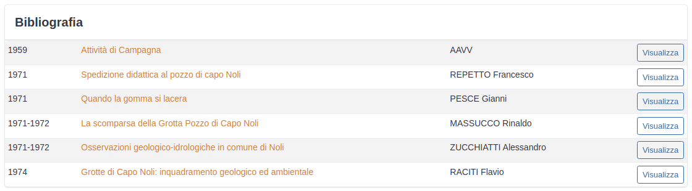

In Liguria, sotto la scheda, compaiono anche le schede storiche del Catasto G.S.L. Issel e,
per i curatori, i documenti della Delegazione Speleologica Ligure.

In fondo, **Se desideri modificare i dati scarica questa scheda** scarica il modulo offline
già compilato con i dati della grotta, da correggere e inviare al catasto.

### Storico delle versioni

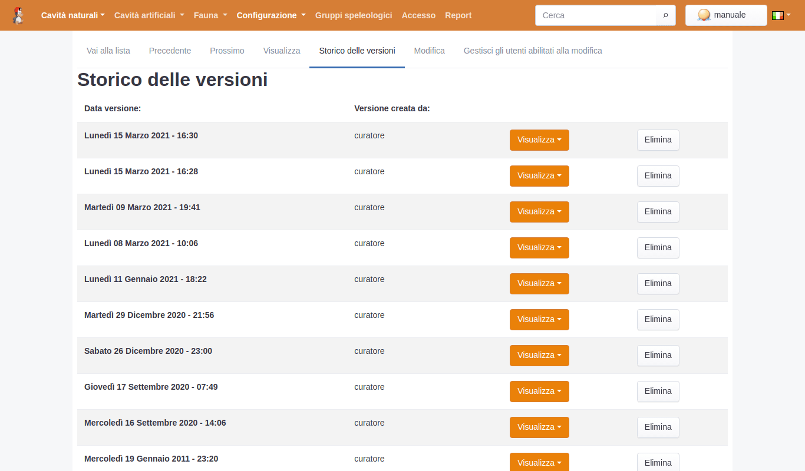

A ogni salvataggio OpenKIS conserva la versione precedente della scheda, compresi i file.
*Storico delle versioni* (per gli amministratori del catasto) elenca le versioni con data e
autore: *Visualizza* apre la scheda com'era, *Elimina* cancella quella versione. Non c'è un
pulsante di ripristino: per tornare a un valore precedente lo si copia dalla versione
vecchia nella scheda attuale.

---

## 5. Inserire e modificare le schede

### Chi può modificare

Una scheda può essere modificata:

- dagli amministratori del sito;
- dai membri del gruppo che amministra l'archivio (per le grotte di solito `w_caves`);
- da chi ha creato la scheda;
- dagli utenti aggiunti in *Gestisci gli utenti abilitati alla modifica*.

Chi può inserire nuove schede lo decide l'amministratore (di solito lo stesso gruppo
`w_caves`). Per le altre persone c'è il modulo offline (vedi sotto).

### Nuova scheda

In fondo all'elenco delle grotte, **Aggiungi nuovo** apre il modulo vuoto (regione e
nazione sono già compilate). In Liguria, se si lascia vuoto il campo **Numero**, al
salvataggio viene assegnato automaticamente un numero libero con il prefisso `LI`.

Dopo il salvataggio, nella stessa pagina si aggiungono rilievi, foto, rilevamenti
faunistici e allegati.

### Il modulo di modifica

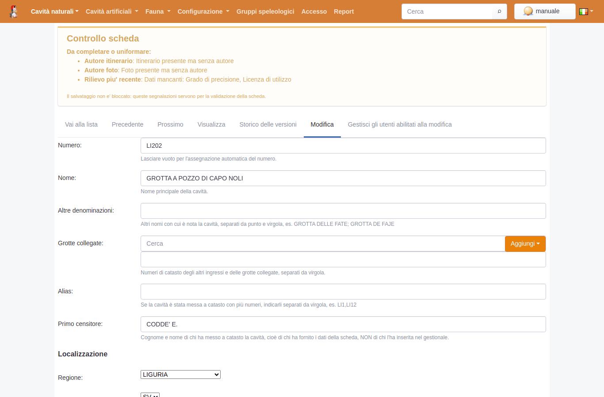

Il riquadro **Controllo scheda** in cima elenca i dati mancanti o incoerenti secondo le
regole del catasto (per esempio un itinerario senza autore, un rilievo senza licenza). Sono
avvisi: il salvataggio non è bloccato.

Sotto ogni campo c'è una breve spiegazione. I campi sono raggruppati:

- **Identificazione**: *Numero*, *Nome*, *Altre denominazioni* (separate da punto e
  virgola), *Grotte collegate* (altri ingressi e grotte comunicanti: si cerca la grotta e si
  preme *Aggiungi*), *Alias* (numeri catastali precedenti), *Primo censitore*.
- **Localizzazione**: *Regione*, *Provincia* e *Comune* (ogni elenco dipende dal
  precedente), *Località*, *Monte*, *Valle*, *Area carsica*, *Formazione geologica*,
  *Litologia*.
- **Dimensioni**: *Sviluppo reale*, *Sviluppo planimetrico*, *Estensione*, *Sviluppo
  riferito a* (intera grotta o solo il ramo di questo ingresso), *Dislivello positivo*,
  *negativo* e *totale*, in metri.
- **Posizione dell'ingresso**: coordinate, quote, carta e valutazione del dato (vedi sotto).
- **Riferimenti a censimenti speciali**: cavità archeologica, marina, lacustre, rischio
  ambientale, grotta turistica, cavità chiusa (con le note di accesso), cavità distrutta,
  posizione verificata sul campo.
- **Descrizione**: idrologia, andamento, percorribilità, gruppi, cronologia catastale,
  note, descrizione, itinerario, sequenza pozzi, fauna, meteorologia, geologia, storia.
- **Immagine ingresso** e **autori** dei testi e della foto.
- **Note relative a questa versione della scheda**: una riga che spiega la modifica; resta
  nello storico.

*Salva* registra la scheda, *Annulla* esce senza salvare.

### Le coordinate

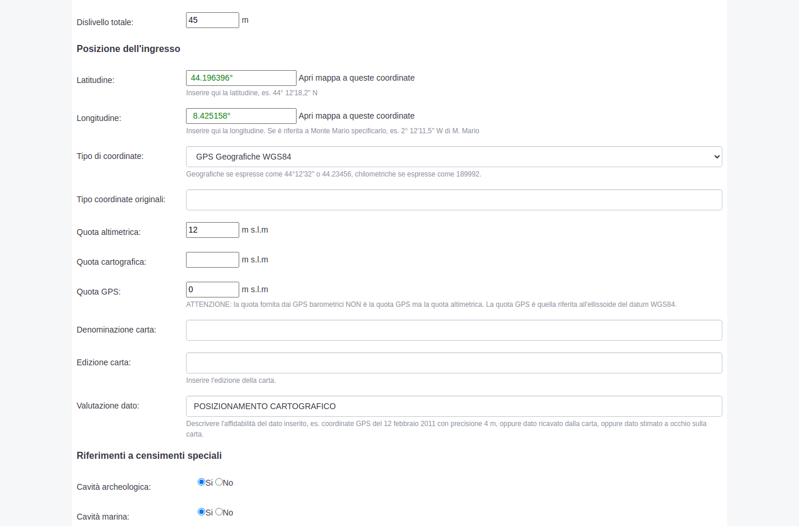

Le coordinate si scrivono come sono state rilevate, scegliendo il **Tipo di coordinate**
corrispondente (WGS84, ED50, Roma 1940/Monte Mario, Gauss-Boaga, UTM, ...):

- coordinate geografiche in gradi sessagesimali (`44°12'18,2'' N`) o decimali
  (`44.196396`); per le longitudini riferite a Monte Mario si indica `W di M. Mario`;
- coordinate piane (Gauss-Boaga, UTM) in metri, es. `1489992`.

OpenKIS calcola le coordinate WGS84 per mappe ed esportazioni. Il link **Apri mappa a
queste coordinate** mostra subito dove cade il punto con il tipo scelto, utile per scoprire
un sistema di riferimento sbagliato:

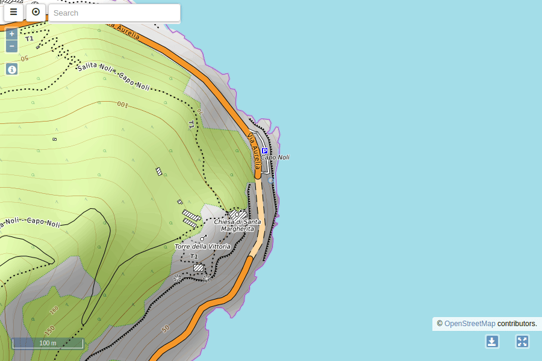

Le quote sono tre: *altimetrica* (dalla carta o dall'altimetro), *cartografica* e *GPS*.
Attenzione: la quota dei GPS non barometrici è riferita all'ellissoide WGS84, non al livello
del mare. In *Valutazione dato* si descrive l'affidabilità della posizione (es. "GPS 12
febbraio 2011, precisione 4 m" oppure "posizionamento cartografico").

### Visibilità e stato dei dati

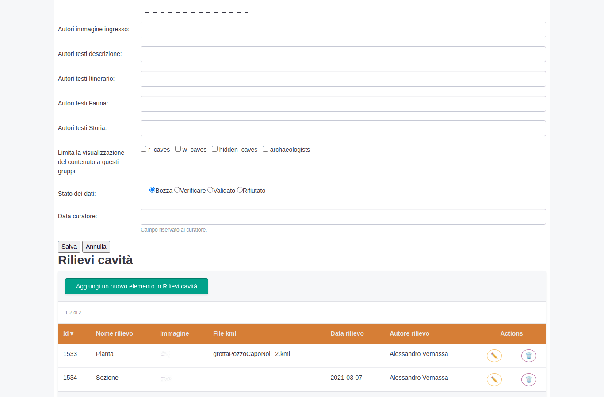

- **Limita la visualizzazione del contenuto a questi gruppi**: se non si sceglie nessun
  gruppo la scheda è visibile a tutti quelli che vedono l'archivio; scegliendo uno o più
  gruppi (es. `hidden_caves` per una grotta da proteggere, `archaeologists` per un sito
  archeologico) la vedono solo quei gruppi, i curatori e gli amministratori. Le schede
  riservate spariscono anche da elenchi, mappe ed esportazioni.
- **Stato dei dati**: *Bozza*, *Verificare*, *Validato*, *Rifiutato*; compare come etichetta
  nell'elenco e nella scheda.
- **Data curatore**: campo riservato al curatore.

Sotto il modulo, le tabelle **Rilievi cavità**, **Foto della cavità**, **Rilevamenti
faunistici** e **Allegati** hanno il pulsante *Aggiungi un nuovo elemento* e, per ogni riga,
le icone per modificarla o eliminarla. Ogni rilievo ha immagine, file sorgente, KML, PDF,
file Therion (`.lox`) o nuvola di punti (`.las`), data, autori, licenza e precisione.

In Liguria il modulo ha anche *Inserimento rapido foto* e, se configurato, un pulsante che
fa analizzare il disegno del rilievo da un servizio di intelligenza artificiale.

### Utenti abilitati alla modifica

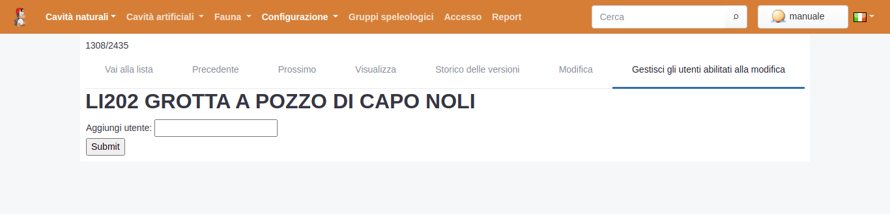

*Gestisci gli utenti abilitati alla modifica* aggiunge o toglie singoli utenti che possono
modificare quella scheda anche senza far parte del gruppo dei curatori. Chi crea una scheda
è aggiunto automaticamente.

### Eliminare una scheda

Se l'amministratore ha abilitato l'eliminazione, chi gestisce la scheda vede il pulsante
per eliminarla, con una pagina di conferma. Di solito la scheda viene solo nascosta, non
cancellata dal database.

### Proporre dati senza account

Chi non può modificare il catasto può comunque proporre dati:

- **Scarica scheda per l'inserimento** (in fondo all'elenco) scarica un modulo vuoto per una
  nuova grotta;
- **Se desideri modificare i dati scarica questa scheda** (in fondo a una scheda) scarica il
  modulo già compilato.

Il modulo è una pagina HTML da aprire nel browser anche senza connessione. Dopo averlo
compilato si può *inviarlo per email* al catasto, *salvarlo su disco* o, se si ha un
account, *aprirlo nel sito con questi dati*.

---

## 6. Gli altri archivi

Tutti gli archivi funzionano come quello delle grotte: elenco con ricerca, filtri e
categorie, scheda, modulo di modifica, storico (dove attivato) ed esportazioni.

| Archivio | Menu | Contenuto |
| --- | --- | --- |
| Cavità artificiali | Cavità artificiali | Miniere, gallerie, bunker, acquedotti, ... con rilievi, foto e allegati; gruppi `r_artificials`/`w_artificials` |
| Sorgenti carsiche | Cavità naturali | Sorgenti con posizione, portata e uso dell'acqua; possono essere punto di rilevamento di un tracciamento |
| Tracciamenti | Cavità naturali | Prove con traccianti (acqua o aria): punto di immissione, punto di rilevamento (grotta, sorgente o coordinate libere per un punto che non è un ingresso), tracciante, data, esito; sopra l'elenco una mappa con le frecce dei tracciamenti positivi |
| Temperature | Cavità naturali | Misure della temperatura sotterranea secondo le schede del progetto UCC: letture spot e monitoraggi con data logger di aria, acqua o roccia, con posizione, condizioni, strumento e fonte; mappa dei punti colorati per temperatura; esportazione CSV nel formato dei fogli UCC (vedi [TEMPERATURES_IT.md](TEMPERATURES_IT.md)) |
| Aree speleologiche | Cavità naturali | Le aree carsiche; la scheda dell'area elenca le sue grotte |
| Complessi carsici | Cavità naturali | Sistemi di più grotte; lo sviluppo può essere ricalcolato dalle grotte che ne fanno parte |
| Rilievi | Cavità naturali | Tutti i rilievi, anche dei complessi carsici |
| Bibliografia | Cavità naturali | Pubblicazioni con autori, anno, rivista, riassunto e file; collegate a grotte, cavità artificiali e fauna |
| Fauna cavernicola | Fauna | Le specie (classificazione, foto); gruppi `r_fauna`/`w_fauna` |
| Rilevamenti faunistici | Fauna | Le osservazioni di una specie in una grotta o cavità artificiale |
| Speleologia glaciale | Speleologia glaciale (dove attiva) | Cavità glaciali, loro rilievi e ghiacciai |
| Gruppi speleologici | Gruppi speleologici | I gruppi con logo, provincia, se sono attivi e il loro bollettino |

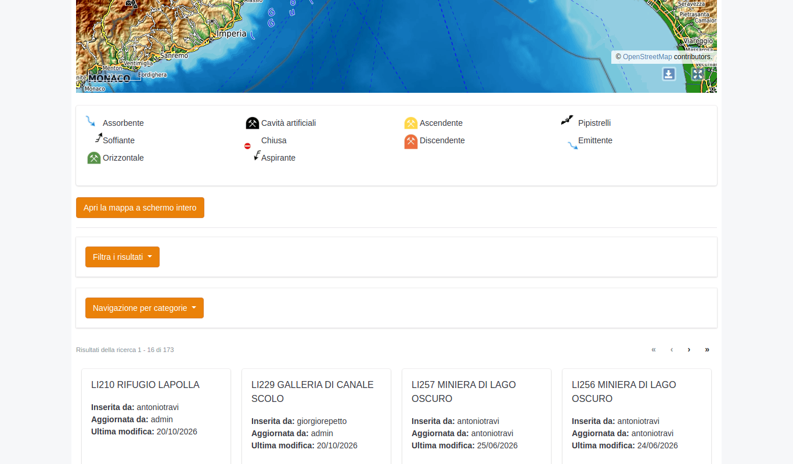

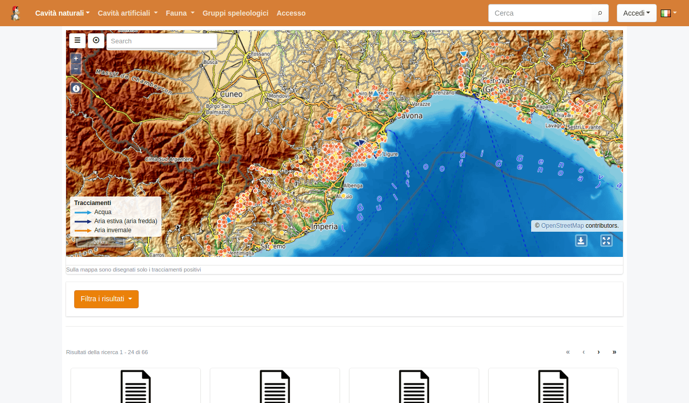

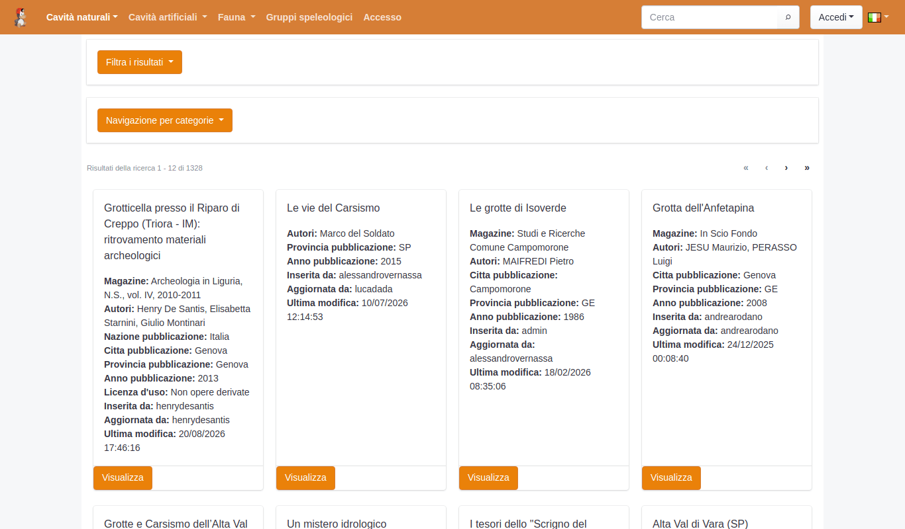

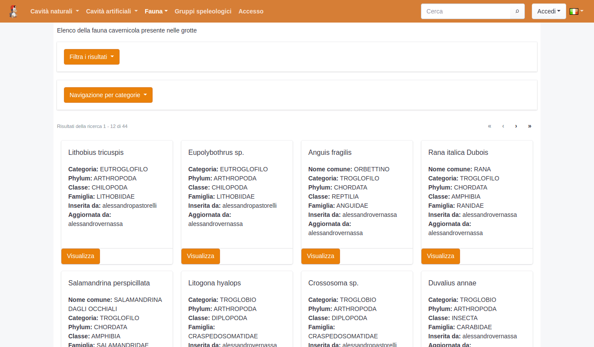

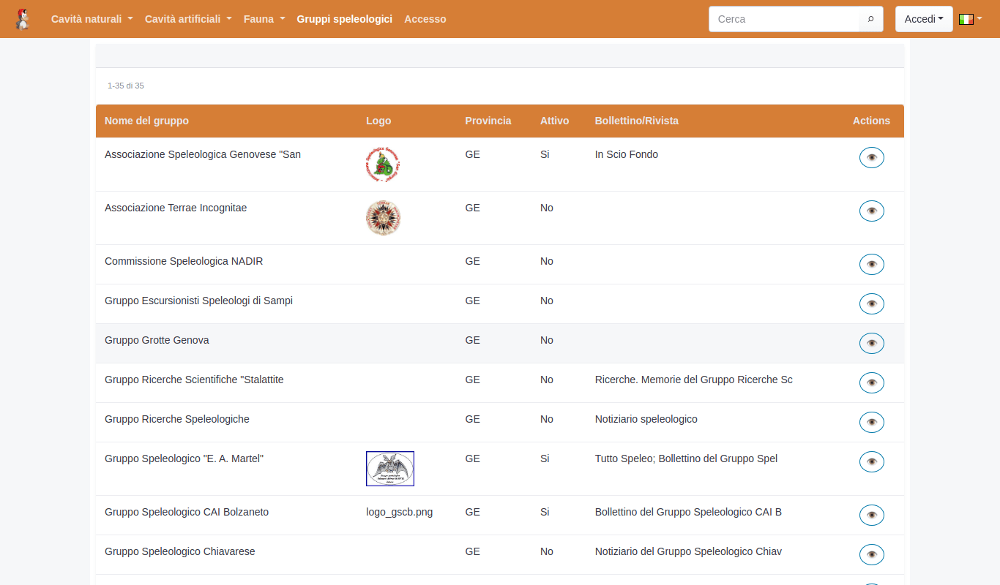

---

## 7. Esportare i dati

Le esportazioni contengono solo le schede che l'utente può vedere e solo quelle con
coordinate valide. Dall'elenco delle grotte esportano tutti i risultati della ricerca, non
solo la pagina visibile.

| Formato | Dove | Uso |
| --- | --- | --- |
| CSV | Elenco, *Esporta i risultati* | Foglio di calcolo con i campi della scheda |
| KML (Google Earth) | Elenco | Per Google Earth: icone con indirizzo completo |
| KML | Elenco, mappa della scheda | GIS, GPS, app di navigazione |
| GPX | Elenco | GPS; ogni punto riporta anche le coordinate originali e il loro tipo |
| SHAPEFILE | Elenco | GIS (QGIS, ArcGIS): ZIP con punti 3D e i campi principali, coordinate WGS84 |
| Karstlink (CSV, JSON-LD) | `openkis_karstlink.php` | Scambio dati con Grottocenter e altri database (vedi sotto) |
| Report CSV | *Report* | Stato di completezza delle schede (vedi [Report](#report)) |

Gli indirizzi delle esportazioni accettano gli stessi filtri dell'elenco, per esempio
`openkis_kml.php?mod=caves&filter_code=LI202` esporta una sola grotta.

---

## 8. Grottocenter

[Grottocenter](https://grottocenter.org) è il database collaborativo delle grotte del mondo.
Contiene già molte grotte italiane, spesso importate anni fa dai catasti regionali: stesse
coordinate, ma senza numero di catasto e con nomi a volte troncati.

OpenKIS fa due cose:

1. **esporta** le grotte pubbliche nel formato **Karstlink**, lo standard di scambio dati
   dell'UIS che Grottocenter può importare;
2. **collega** ogni grotta del catasto alla stessa grotta su Grottocenter: la ricerca
   propone i collegamenti, il curatore li conferma e il collegamento compare nella scheda.

Su Grottocenter non viene scritto nulla: OpenKIS legge solo la sua API pubblica, senza
account.

La pagina è in **Configurazione > Grottocenter** ed è riservata agli amministratori
dell'archivio grotte (es. `w_caves`) e del sito.

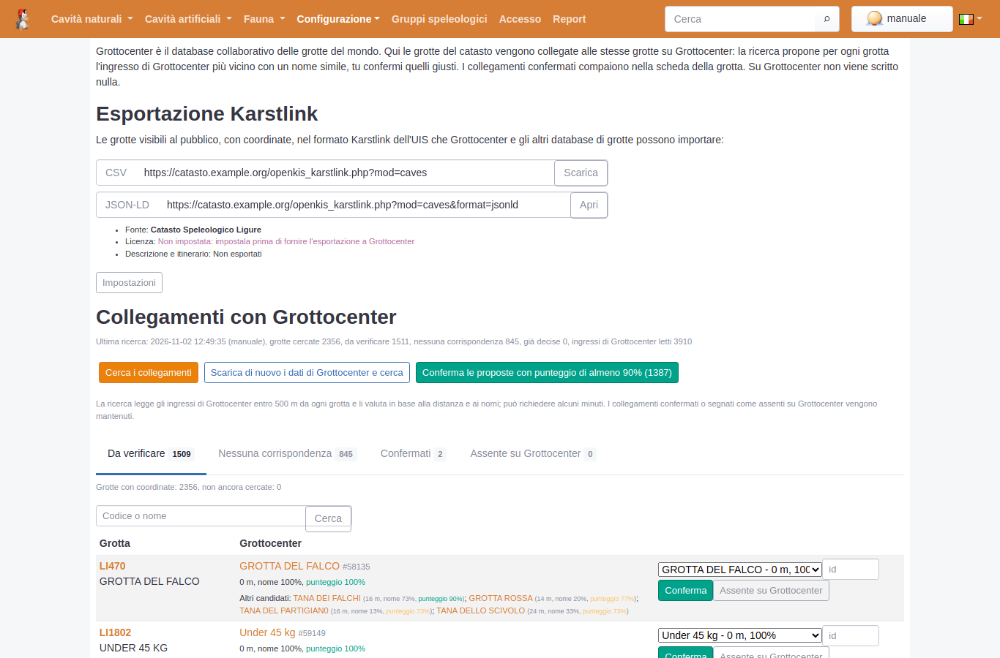

### Esportazione Karstlink

La parte alta della pagina mostra i due indirizzi dell'esportazione:

```text
https://<sito>/openkis_karstlink.php?mod=caves                  CSV
https://<sito>/openkis_karstlink.php?mod=caves&format=jsonld    JSON-LD
```

- Contiene le grotte che un visitatore può vedere, con coordinate valide.
- Per ogni grotta: numero di catasto e altri nomi (in `gn:alternateName`), coordinate WGS84,
  quota, precisione della posizione, sviluppo, dislivelli, se è turistica o chiusa,
  l'indirizzo della scheda come fonte e, se confermato, l'ingresso di Grottocenter
  corrispondente (`owl:sameAs`).
- Sotto gli indirizzi sono riassunte le impostazioni: **fonte** (il nome del catasto),
  **licenza** dei dati, se descrizione e itinerario sono esportati.

Prima di dare l'esportazione a Grottocenter, un amministratore del sito deve scegliere la
licenza in **Impostazioni** (Grottocenter non importa dati senza licenza).

### Cercare i collegamenti

**Cerca i collegamenti** legge da Grottocenter gli ingressi vicini a ogni grotta e propone
per ognuna l'ingresso più probabile; può richiedere alcuni minuti. I dati di Grottocenter
scaricati restano validi per alcune ore (24 di default): **Scarica di nuovo i dati di
Grottocenter e cerca** li aggiorna prima della ricerca. In Liguria la ricerca ha
esaminato 2.356 grotte e 3.910 ingressi di Grottocenter e ha proposto 1.511 collegamenti,
1.389 con punteggio di almeno il 90%.

Una nuova ricerca mantiene i collegamenti già confermati o segnati come assenti e
sostituisce solo le proposte.

### Il punteggio

Ogni ingresso entro la distanza massima (500 m) riceve un punteggio da 0 a 100% che combina:

- **il nome**: si confrontano le parole che distinguono la grotta, ignorando le parole
  generiche (*grotta*, *tana*, *arma*, *buranco*, *pozzo*, ...) e gli articoli; i nomi
  troncati o scritti in modo diverso contano comunque; un numero di catasto nel nome su
  Grottocenter (es. `[LI1878]`) vale come nome uguale;
- **la distanza**: a pochi metri la sola distanza vale quasi il 90%, a 100 m meno del 20%.

Basta uno dei due per un punteggio alto: lo stesso nome a qualche centinaio di metri, o un
nome troncato a pochi metri. Ogni ingresso di Grottocenter viene proposto per una sola
grotta, quella con il punteggio migliore. Sotto il 40% la grotta va in *Nessuna
corrispondenza*.

### Verificare le proposte

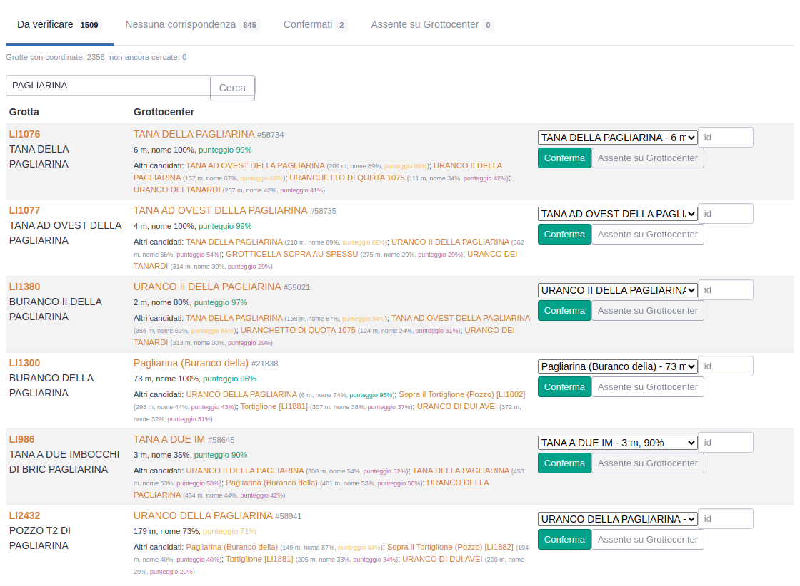

Le grotte sono divise in quattro schede: **Da verificare**, **Nessuna corrispondenza**,
**Confermati**, **Assente su Grottocenter**, con una casella per cercare per numero o nome.

Per ogni grotta la riga mostra:

- a sinistra il numero e il nome nel catasto (link alla scheda);
- al centro l'ingresso proposto (link alla pagina di Grottocenter) con il suo numero,
  distanza, somiglianza del nome e punteggio, e sotto gli **altri candidati**;
- a destra le azioni:
  - **Conferma** registra il collegamento con il candidato scelto nell'elenco a tendina;
  - la casella **id** permette di inserire a mano il numero di un altro ingresso di
    Grottocenter (si legge nell'indirizzo della sua pagina,
    `grottocenter.org/ui/entrances/<id>`); se è lontano dalla grotta compare un avviso;
  - **Assente su Grottocenter** segna che la grotta non c'è.

Nell'esempio, il *Buranco della Pagliarina* (LI1300) ha due candidati: *Pagliarina
(Buranco della)* a 73 m, con il nome completo, e *URANCO DELLA PAGLIARINA* a 6 m, una copia
con il nome troncato importata anni fa. Entrambi sono plausibili: il curatore sceglie quello
giusto dall'elenco prima di confermare.

**Conferma le proposte con punteggio di almeno 90%** conferma in un colpo solo tutte le
proposte sopra la soglia (il numero tra parentesi dice quante sono). Conviene controllarne
qualcuna a campione prima, e poi verificare una per una quelle sotto la soglia.

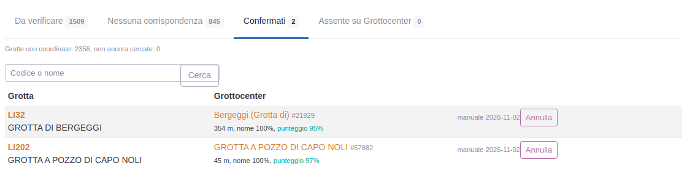

Nella scheda *Confermati* ogni riga riporta chi ha confermato e quando; **Annulla** toglie
il collegamento, che verrà riproposto alla ricerca successiva.

I collegamenti confermati compaiono nella scheda della grotta (riquadro *Grottocenter*,
pulsante *Vedi su Grottocenter*) e nell'esportazione Karstlink.

### Impostazioni

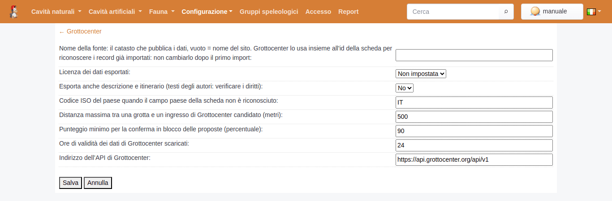

Le impostazioni cambiano l'esportazione pubblica, quindi le modificano solo gli
amministratori del sito.

| Impostazione | Predefinito | Note |
| --- | --- | --- |
| Nome della fonte | nome del sito | Grottocenter lo usa con l'id della scheda per riconoscere i record già importati: non cambiarlo dopo il primo import |
| Licenza dei dati esportati | non impostata | CC-BY, CC-BY-SA, ODbL, ODC-By; necessaria per l'import |
| Esporta anche descrizione e itinerario | no | Sono testi degli autori: verificare prima i diritti |
| Codice ISO del paese | IT | Usato quando il paese della scheda non è riconosciuto |
| Distanza massima | 500 m | I candidati più lontani sono ignorati |
| Punteggio minimo per la conferma in blocco | 90% | |
| Ore di validità dei dati scaricati | 24 | |
| Indirizzo dell'API | `https://api.grottocenter.org/api/v1` | |

### Cosa non fa ancora

L'invio a Grottocenter delle grotte che mancano non è automatico: richiede un account
Grottocenter abilitato all'import, l'accordo con il team di Grottocenter e una licenza per
i dati. Il file Karstlink è già nel formato del loro importatore. Dettagli tecnici in
[GROTTOCENTER_IT.md](GROTTOCENTER_IT.md).

---

## 9. Assistenti AI (server MCP)

OpenKIS può essere interrogato da un assistente AI (Claude, ChatGPT, ...) tramite il
protocollo MCP: si possono fare domande in linguaggio naturale ("quali grotte del comune di
Noli superano i 100 m di sviluppo?") e, se autorizzati, aggiornare le schede. L'assistente
lavora con gli stessi permessi dell'utente sul sito.

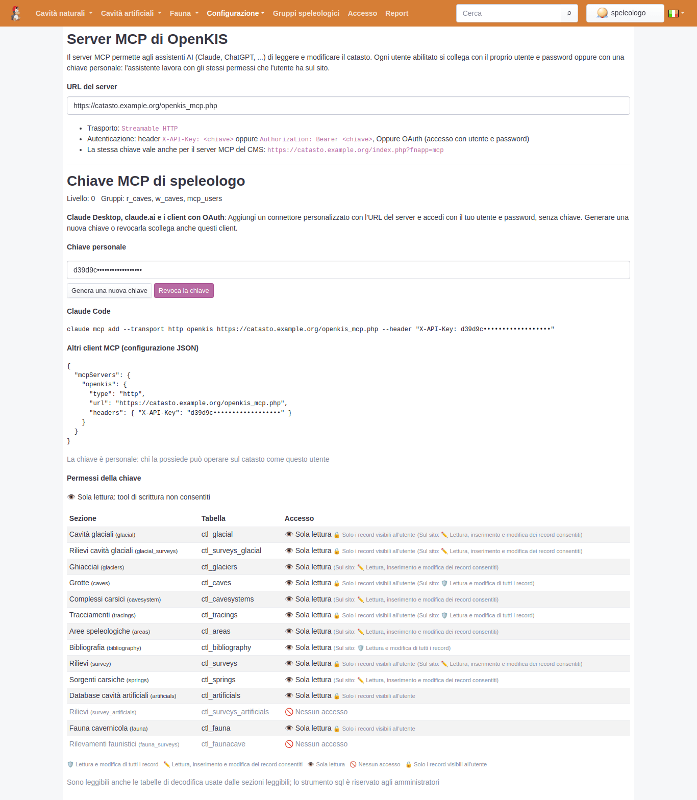

La pagina è **Configurazione > Server MCP**:

- un amministratore **abilita** l'utente (gruppo `mcp_users`); di default l'accesso è in
  **sola lettura**, la scrittura va concessa a parte (gruppo `mcp_write`);
- l'utente abilitato vede l'indirizzo del server, genera la sua **chiave personale** e
  trova il comando per Claude Code e la configurazione JSON per gli altri client;
- Claude Desktop, claude.ai e gli altri client con OAuth non hanno bisogno della chiave:
  basta aggiungere l'indirizzo del server come connettore e accedere con utente e password;
- la tabella **Permessi della chiave** mostra, archivio per archivio, cosa può leggere o
  modificare.

La chiave è personale: chi la possiede opera sul catasto a nome dell'utente. *Genera una
nuova chiave* o *Revoca la chiave* scollegano tutti i client. Dettagli in
[MCP_SERVER_IT.md](MCP_SERVER_IT.md).

---

## 10. Amministrazione

Questo capitolo è per gli amministratori del sito. L'installazione è descritta nel
[README](../README.md).

### Il pannello di controllo

Si apre da `index.php?fnapp=controlcenter` (o dal menu dell'utente). Il menu a sinistra
contiene:

- **Contenuti**: *Pagine e struttura sito* (le sezioni del sito, il loro ordine e i
  permessi), blocchi, file;
- **Impostazioni generali**: *Configurazione generale* (nome del sito, lingue, tema, pagina
  iniziale, registrazione, email), *Aspetto* (temi), e le opzioni di ogni archivio
  (*Pagina dbview: Grotte*, ...);
- **Utenti e gruppi**: utenti, gruppi, condizioni di registrazione, campi del profilo;
- **Utilità**: utenti del pannello di controllo, operazioni pianificate, registro eventi,
  invio email, informazioni sul server, *aggiorna dati mappe*.

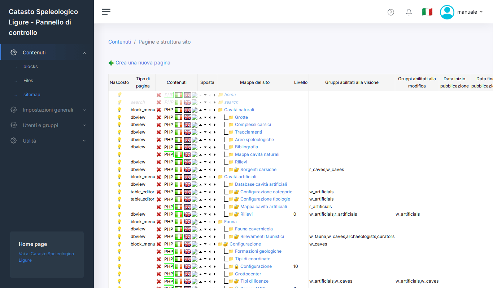

*Pagine e struttura sito* mostra l'albero delle sezioni. Per ognuna si impostano: nascosta
o no, tipo, **livello** minimo, **gruppi abilitati alla visione**, **gruppi abilitati alla
modifica** della pagina e date di pubblicazione. Una sezione nascosta non compare nel menu
ma resta raggiungibile dal suo indirizzo.

### Utenti e gruppi

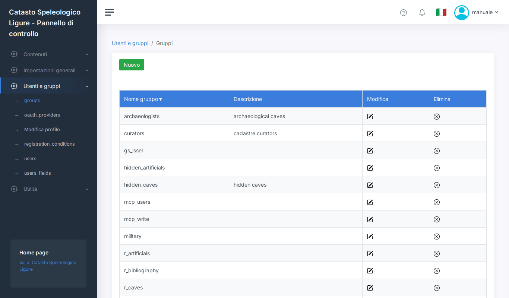

I gruppi principali di OpenKIS:

| Gruppo | Significato |
| --- | --- |
| `r_caves`, `r_artificials`, `r_fauna` | Lettura delle sezioni riservate dell'archivio |
| `w_caves`, `w_artificials`, `w_fauna` | Inserimento e modifica (curatori) |
| `hidden_caves`, `archaeologists` | Vedono le schede riservate a quei gruppi |
| `mcp_users`, `mcp_write` | Uso del server MCP, e in scrittura |

I gruppi `r_`/`w_` e `mcp_` vengono creati da OpenKIS; altri gruppi si creano con *Nuovo*.

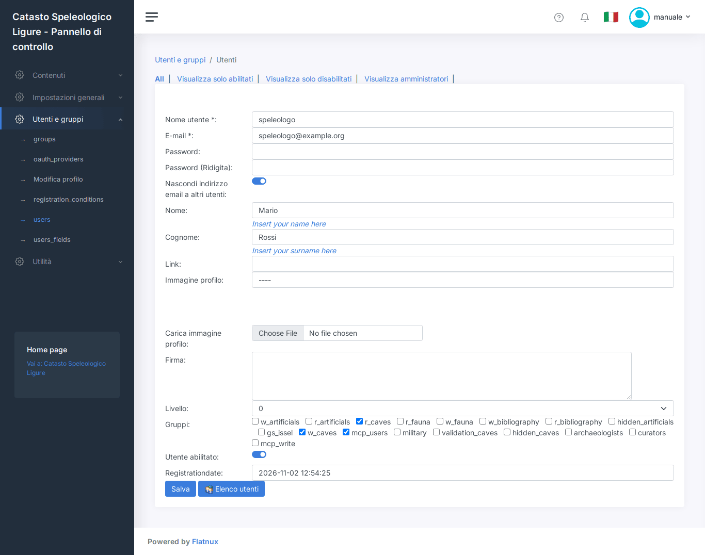

Per dare i permessi a un utente: **Utenti e gruppi > Utenti**, aprire l'utente e spuntare i
gruppi. Il **livello** 10 rende l'utente amministratore del sito: usarlo solo per chi
gestisce il sito, ai curatori bastano i gruppi. *Utente abilitato* sospende o riattiva
l'account.

### Permessi degli archivi

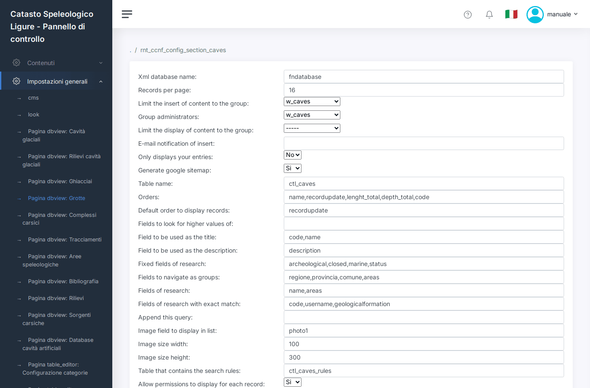

In *Impostazioni generali > Pagina dbview: Grotte* (e simili) si configurano gli archivi.
Le opzioni più importanti:

- **Limit the insert of content to the group** (`groupinsert`): chi può inserire nuove
  schede. **Se è vuoto può inserire qualsiasi utente registrato**: impostarlo sempre (es.
  `w_caves`).
- **Group administrators** (`groupadmin`): chi può modificare tutte le schede e vedere lo
  storico.
- **Limit the display of content to the group** (`groupview`): chi può leggere l'archivio;
  vuoto = pubblico.
- **Allow permissions to display for each record** e **gruppi per i permessi dei record**:
  attivano il campo *Limita la visualizzazione* nelle schede e scelgono i gruppi proposti.
- ricerca, ordinamento, campi delle categorie, numero di schede per pagina, storico,
  esportazioni, eliminazione, modulo offline, mappa del sito per i motori di ricerca.

Gli amministratori del sito possono anche impostare in blocco i gruppi di visibilità delle
schede con la pagina *Controllo accessi* in fondo all'elenco.

### Configurazione generale e temi

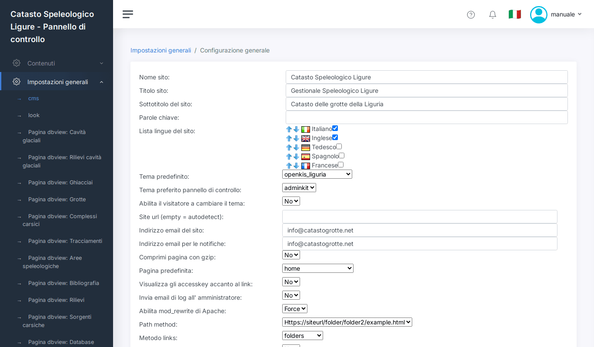

*Configurazione generale* contiene nome e titolo del sito, lingue, tema, pagina iniziale,
email del sito, registrazione degli utenti (aperta, con conferma via email, captcha) e
indirizzi.

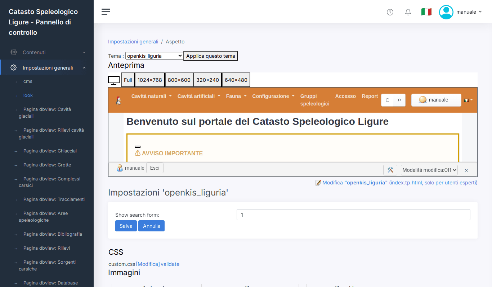

*Aspetto* mostra l'anteprima dei temi, applica quello scelto e ne modifica le opzioni e il
CSS. OpenKIS ha il tema base `openkis`, le varianti regionali (`openkis_liguria`,
`openkis_lombardia`, `openkis_piemonte`, `openkis_umbria`, `openkis_wish`) e
`openkis_grottocenter`, che riprende l'aspetto di grottocenter.org. Le opzioni di un tema
vengono copiate nel database al primo uso: le modifiche successive al file `config.php` del
tema non cambiano un sito già installato, vanno fatte da questa pagina.

### Configurazione di OpenKIS

Nel menu *Configurazione* del sito:

- **Configurazione**: centro e zoom iniziali della mappa;

  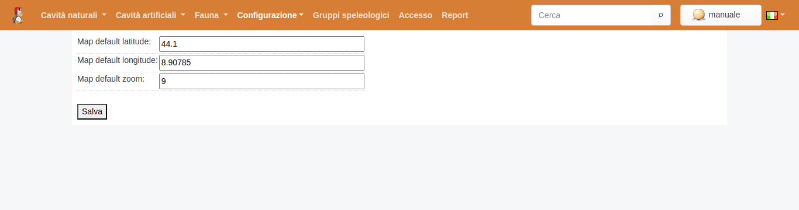

- **Tipi di coordinate**: i sistemi di riferimento accettati nelle schede, ognuno con la
  definizione proj4 usata per la conversione in WGS84;

  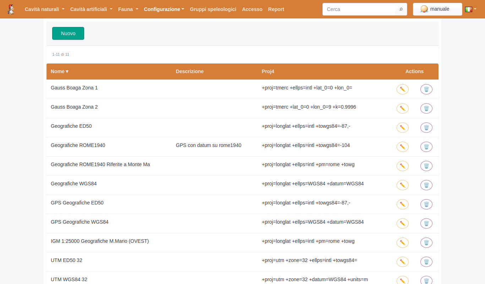

- **Formazioni geologiche** e **Tipi di licenze**: tabelle usate nei moduli;
- **Grottocenter** e **Server MCP**: vedi i capitoli precedenti.

*Tipi di coordinate* e *Formazioni geologiche* sono tabelle condivise da tutte le schede e
le può modificare qualsiasi utente che apre la pagina: limitarne l'accesso ai curatori o
agli amministratori con il *livello* o i *gruppi abilitati alla visione* in *Pagine e
struttura sito*.

### Report

*Report* elenca per ogni grotta rilievi, foto, descrizione, itinerario, posizione, ultimo
aggiornamento, visibilità e stato dei dati, ed esporta il tutto in CSV: serve a pianificare
il lavoro dei curatori. Il report mostra **tutte** le grotte, comprese quelle riservate:
limitarne la visione ai curatori con i *gruppi abilitati alla visione* della sezione.

### Personalizzazione regionale

Il file `extra/openkis_config.local.php` indica il catasto con `$_FN['openkis_custom']`
(es. `liguria`). La cartella `extra/openkis/custom/<regione>/` può contenere:

- la numerazione automatica delle schede e i valori predefiniti dei nuovi moduli;
- il centro predefinito della mappa;
- i riquadri della scheda (`viewfooter_caves.php`: coordinate in più formati, scheda
  catastale PDF, documenti storici);
- le regole del *Controllo scheda* (`validator_caves.php`);
- il modulo offline personalizzato;
- i livelli della mappa (`bs_map/conf/layers_<regione>.js`).

La cartella `custom/example` è il modello da copiare per un nuovo catasto.

### Manutenzione

- **Aggiorna dati mappe** (*Utilità*): ricalcola le coordinate e svuota la cache delle mappe
  e delle esportazioni. Serve solo dopo modifiche fatte direttamente nel database; le
  modifiche fatte dal sito aggiornano la cache da sole.
- **Indici del database**: `sql/openkis_indexes.sql` velocizza le pagine con molte schede
  (vedi [INDEXES.md](../INDEXES.md)); va rieseguito dopo gli aggiornamenti.
- **Backup**: salvare il database MySQL, la cartella `misc/` (definizioni delle tabelle,
  impostazioni e tutti i file caricati: foto, rilievi, allegati) e
  `extra/openkis_config.local.php`.
- **Aggiornamenti**: aggiornare il codice (`git pull` e `git submodule update`), poi
  rieseguire gli indici. Per i siti precedenti al 25/03/2024 c'è anche lo script SQL in
  `extra/openkis/update.md`.

---

## 11. Glossario

| Termine | Significato |
| --- | --- |
| Catasto | Registro ufficiale delle grotte di una regione; ogni grotta ha un numero (es. LI202) |
| Scheda | Il record di una grotta (o di una sorgente, di un rilievo, ...) |
| Sviluppo reale | Somma delle lunghezze di tutte le gallerie, misurate nelle tre dimensioni |
| Sviluppo planimetrico | Somma delle lunghezze proiettate sul piano orizzontale |
| Estensione | Massima distanza in pianta tra due punti della grotta |
| Dislivello | Differenza di quota rispetto all'ingresso, positivo (sopra) e negativo (sotto) |
| Rilievo | Il disegno topografico della grotta (pianta, sezione), con i file del rilievo |
| Tracciamento | Prova con un tracciante per seguire il percorso dell'acqua o dell'aria |
| Curatore | Chi gestisce le schede di una provincia o di un archivio |
| Karstlink | Standard UIS per lo scambio di dati sulle grotte |
| Grottocenter | Database collaborativo mondiale delle grotte |
| MCP | Model Context Protocol, il protocollo con cui gli assistenti AI usano strumenti esterni |
